# GripSense TinyML - FSR Grip Gesture Classification Report

_Generated 2026-10-10T14:34:48+00:00 by `run_experiment.py` (seed 42). Every number in this
report is read from `reports/metrics.json` and the files in `results/`; nothing is hand-entered._

## Executive summary

GripSense classifies a 3-second force-sensitive-resistor (FSR) recording from an ESP32 into four
assistive-communication intents: **LIGHT_PRESS (Hungry)**, **HARD_PRESS (Pain)**, **DOUBLE_SQUEEZE
(Washroom)** and **NO_PRESS (Idle/resting)**. This phase ran fully offline on the existing CSV
(`gripsense_clean_data.csv`, 30,000 readings, 200 trials). No hardware was used.

- **Dataset audit (before training):** structurally clean (no missing values, duplicates, label
  conflicts, timing irregularities or saturation). 20 trials were flagged as
  atypical and kept. **Main risk:** each class was recorded as one contiguous block of trials, so class
  is confounded with recording session.
- **Baseline (validation):** majority class = 0.250 accuracy; single-feature
  nearest-centroid on mean ADC = 0.725 accuracy / 0.714 macro-F1.
- **Selected model:** RandomForest `{"n_estimators": 300, "max_depth": null, "min_samples_leaf": 1, "max_features": "sqrt"}`, chosen on validation only.
  Validation accuracy 0.975, macro-F1 0.975.
- **Final held-out test (40 trials, evaluated once):** accuracy **0.975**
  (39/40; 95% Wilson CI 0.871-0.996), macro-F1 **0.975**.
- With only 10 test trials per class from one recording session (and likely one user), these results
  show that the classes are separable **in this dataset**. They do **not** establish real-world reliability.

## 1. Objectives

1. Verify and audit the recorded FSR dataset before any modelling.
2. Build a leakage-free trial-level train/validation/test split (60/20/20, stratified).
3. Establish simple baselines, then train and select ML models using train/validation data only.
4. Report one final, untouched evaluation on the held-out test set, with honest limitations.
5. Produce a model artifact that can be reloaded for inference (a stepping stone toward on-device TinyML).

## 2. Methodology overview

| Stage | What was done | Data used |
|---|---|---|
| Audit | Schema, counts, timing, labels, ADC ranges, per-trial anomaly flags, plots | full CSV (descriptive only) |
| Split | Stratified by label at **trial** level, seed 42 | trial IDs + labels |
| Features | 49 fixed, stateless per-trial features | each trial's own readings |
| Baselines | Majority class; mean-ADC nearest centroid | fit: train · score: validation |
| Model selection | 14 candidates (tree / logistic regression / Random Forest) | fit: train · choose: validation (+ train CV) |
| Final test | Selected model scored once | test (40 trials) |

The script records a timestamped stage log (in `metrics.json`) showing that the pre-training plan was
written before any classifier was fitted and that the test set was scored only after selection.

---

## 3. Dataset findings BEFORE training

### 3.1 Structure and integrity

| category | check | expected | observed | status |
|---|---|---|---|---|
| schema | required columns present | ['trial', 'label', 'elapsed_ms', 'adc'] | ['trial', 'label', 'elapsed_ms', 'adc'] | PASS |
| schema | column dtypes | int,str,int,int | {'trial': 'int64', 'label': 'str', 'elapsed_ms': 'int64', 'adc': 'int64'} | PASS |
| counts | total readings | 30000 | 30000 | PASS |
| counts | unique trials | 200 | 200 | PASS |
| counts | trial IDs contiguous | 1..200 | 1..200 | PASS |
| counts | readings per trial | all 150 | {150: 200} | PASS |
| missing | missing values: trial | 0 | 0 | PASS |
| missing | missing values: label | 0 | 0 | PASS |
| missing | missing values: elapsed_ms | 0 | 0 | PASS |
| missing | missing values: adc | 0 | 0 | PASS |
| duplicates | exact duplicate rows | 0 | 0 | PASS |
| duplicates | duplicate (trial, elapsed_ms) | 0 | 0 | PASS |
| labels | labels within allowed set | ['LIGHT_PRESS', 'HARD_PRESS', 'DOUBLE_SQUEEZE', 'NO_PRESS'] | ['DOUBLE_SQUEEZE', 'HARD_PRESS', 'LIGHT_PRESS', 'NO_PRESS'] | PASS |
| labels | trials with inconsistent labels | 0 | 0 | PASS |
| balance | trials for LIGHT_PRESS | 50 | 50 | PASS |
| balance | readings for LIGHT_PRESS | 7500 | 7500 | PASS |
| balance | trials for HARD_PRESS | 50 | 50 | PASS |
| balance | readings for HARD_PRESS | 7500 | 7500 | PASS |
| balance | trials for DOUBLE_SQUEEZE | 50 | 50 | PASS |
| balance | readings for DOUBLE_SQUEEZE | 7500 | 7500 | PASS |
| balance | trials for NO_PRESS | 50 | 50 | PASS |
| balance | readings for NO_PRESS | 7500 | 7500 | PASS |
| timing | sampling interval (ms) | all 20 | {20: 29800} | PASS |
| timing | trial start elapsed_ms | all 0 | {0: 200} | PASS |
| timing | trial last timestamp (ms) | all 2980 (150 x 20 ms = 3.0 s window) | {2980: 200} | PASS |
| timing | timestamps monotonic within trial (file order) | True | True | PASS |
| adc | ADC min / max | within 0..4095 | 0 / 2608 | PASS |
| adc | saturated readings (>= 4095) | 0 | 0 | PASS |
| protocol | classes recorded in contiguous trial blocks | interleaved/randomised order | LIGHT_PRESS: 1-50; HARD_PRESS: 51-100; DOUBLE_SQUEEZE: 101-150; NO_PRESS: 151-200 | WARN |
| protocol | press events per trial: DOUBLE_SQUEEZE | 2 (one double squeeze) | {3: 13, 4: 20, 5: 11, 6: 5, 7: 1} | WARN |
| quality | trials flagged for review (kept in dataset) | 0 | 20 | WARN |

Full audit (including INFO rows): `reports/dataset_audit.csv`. Per-trial flags: `reports/trial_quality_flags.csv`.

### 3.2 ADC value summary per class (raw readings)

| check | observed |
|---|---|
| ADC stats LIGHT_PRESS | mean=566.8 median=557 std=284.5 min=0 max=2273 zero=1.6% |
| ADC stats HARD_PRESS | mean=1651.5 median=1693 std=496.2 min=0 max=2608 zero=0.4% |
| ADC stats DOUBLE_SQUEEZE | mean=511.9 median=144 std=641.9 min=0 max=2414 zero=45.6% |
| ADC stats NO_PRESS | mean=1.2 median=0 std=24.3 min=0 max=704 zero=99.6% |

ADC values lie in 0-2608
of the 0-4095 range. No saturation. Zero readings are normal for this sensor when unloaded:
NO_PRESS is almost entirely zeros and DOUBLE_SQUEEZE drops to zero between squeezes.

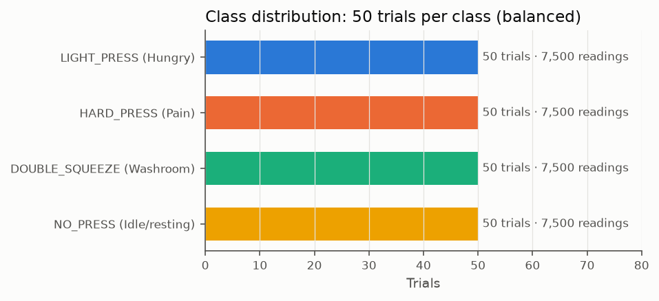

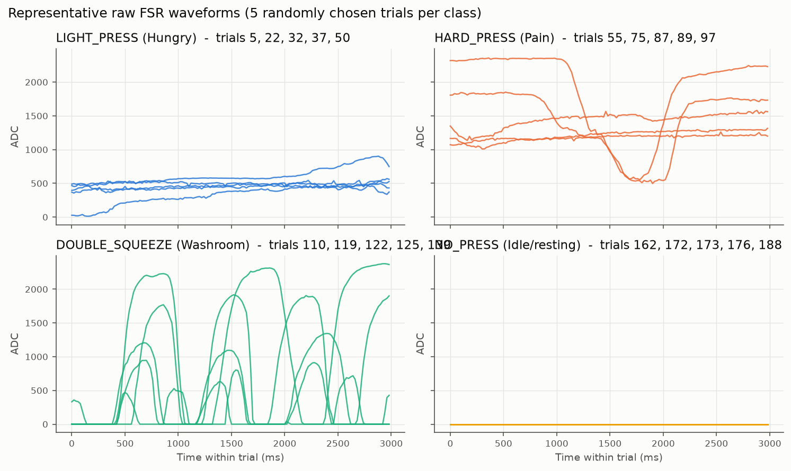

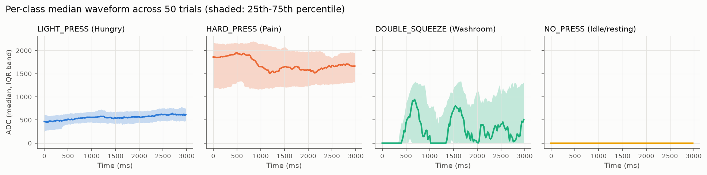

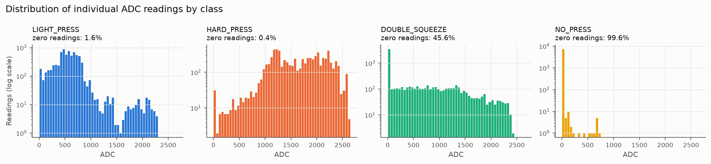

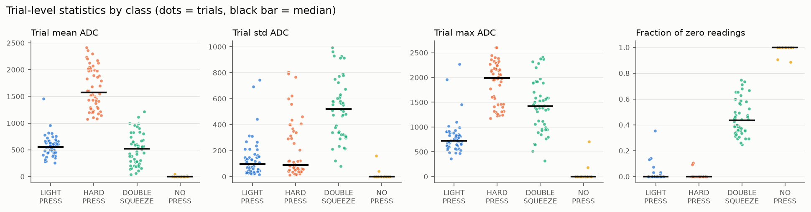

### 3.3 Data-quality concerns

1. **Recording-order confound (most important).** Trials were recorded class-by-class
   (LIGHT_PRESS: 1-50; HARD_PRESS: 51-100; DOUBLE_SQUEEZE: 101-150; NO_PRESS: 151-200). Any drift over time (sensor warm-up, finger placement, user
   fatigue, cable movement) is perfectly aligned with the label. The model could partly learn
   "session" rather than "gesture", and a random split cannot detect this. Trial ID is excluded from
   the features, but the confound itself cannot be fixed in this dataset. Fig. 6 shows visible
   within-block drift (e.g. HARD_PRESS mean force falls over trials 51-100, DOUBLE_SQUEEZE force rises
   over trials 101-120), so recording conditions changed during collection.
2. **Overlap between LIGHT_PRESS and DOUBLE_SQUEEZE by average force.** Their trial means overlap
   heavily (see Fig. 5), so mean force alone cannot separate them. Temporal structure (zeros between
   squeezes, press-event count) is required.
3. **DOUBLE_SQUEEZE trials do not contain a double squeeze.** Counting distinct presses (rising
   crossings of 100 ADC) gives {3: 13, 4: 20, 5: 11, 6: 5, 7: 1}
   (events: trials). No DOUBLE_SQUEEZE trial has exactly 2 presses. The raw waveforms (Fig. 2) show clean,
   separate squeezes repeated for the whole 3-second window. The model therefore learns "repeated
   squeezing", and a user who performs one real double squeeze (2 presses, then rest) would produce a
   pattern absent from the training data. This is a protocol/labelling issue, not sensor noise, and is
   reported as a dataset-level WARN rather than 50 per-trial flags.
4. **Atypical trials (20 flagged, none removed).** Flags use per-class robust
   z-scores (|z| > 3.5 on mean/std/max/zero-fraction/mean |Δ|) plus protocol heuristics (activity during
   NO_PRESS, dropouts to zero during a sustained press, DOUBLE_SQUEEZE with fewer than two presses,
   LIGHT_PRESS peaks above 1500 ADC). The heuristics are review prompts, not proof of mislabelling.
   HARD_PRESS has many high-variability flags: several trials pulse or wobble rather than holding steady.
5. **Nominal timestamps.** All intervals are exactly 20 ms. This is consistent with a logger writing
   nominal sample times, so real sampling jitter cannot be checked from this file.
6. **Unknown provenance details.** The CSV does not record the participant, session or date. All
   trials appear to come from one collection effort, so generalisation to other users or sensor
   placements is untested.

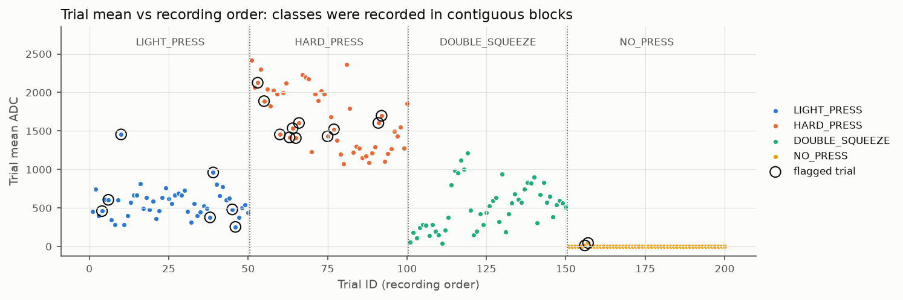

Flagged trials:

| trial | label | flags |
|---|---|---|
| 4 | LIGHT_PRESS | atypical_mean_abs_diff(z=+4.4) |
| 6 | LIGHT_PRESS | atypical_std(z=+7.2); atypical_max(z=+7.3); atypical_zero_fraction(z=+6.3); atypical_mean_abs_diff(z=+6.7); dropout_to_zero_during_press(35%); light_press_peak_in_hard_range(max=1954) |
| 10 | LIGHT_PRESS | atypical_mean(z=+5.7); atypical_std(z=+6.6); atypical_max(z=+9.2); light_press_peak_in_hard_range(max=2273) |
| 38 | LIGHT_PRESS | atypical_mean_abs_diff(z=+3.7) |
| 39 | LIGHT_PRESS | atypical_std(z=+3.9); atypical_max(z=+4.3); atypical_mean_abs_diff(z=+3.7) |
| 45 | LIGHT_PRESS | dropout_to_zero_during_press(14%) |
| 46 | LIGHT_PRESS | dropout_to_zero_during_press(13%) |
| 53 | HARD_PRESS | atypical_std(z=+8.6); atypical_zero_fraction(z=+5.4); dropout_to_zero_during_press(11%) |
| 55 | HARD_PRESS | atypical_std(z=+6.1); atypical_mean_abs_diff(z=+4.1) |
| 60 | HARD_PRESS | atypical_std(z=+8.1); atypical_mean_abs_diff(z=+8.1) |
| 63 | HARD_PRESS | atypical_std(z=+8.4); atypical_zero_fraction(z=+4.8); atypical_mean_abs_diff(z=+5.7) |
| 64 | HARD_PRESS | atypical_std(z=+3.7); atypical_mean_abs_diff(z=+4.9) |
| 65 | HARD_PRESS | atypical_std(z=+5.6); atypical_mean_abs_diff(z=+7.7) |
| 66 | HARD_PRESS | atypical_std(z=+4.1); atypical_mean_abs_diff(z=+5.0) |
| 75 | HARD_PRESS | atypical_std(z=+4.5) |
| 77 | HARD_PRESS | atypical_std(z=+3.8) |
| 91 | HARD_PRESS | atypical_std(z=+6.4) |
| 92 | HARD_PRESS | atypical_std(z=+3.7); atypical_mean_abs_diff(z=+4.6) |
| 156 | NO_PRESS | atypical_zero_fraction(z=-5.6); activity_during_no_press(max=186) |
| 157 | NO_PRESS | atypical_mean(z=+6.9); atypical_std(z=+7.0); atypical_max(z=+6.9); atypical_zero_fraction(z=-4.6); atypical_mean_abs_diff(z=+6.5); activity_during_no_press(max=704) |

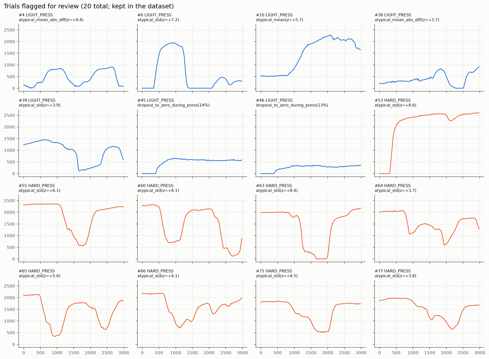

---

## 4. Pre-training plan: dataset, split, features, baseline, evaluation (written 2026-10-10T14:34:36+00:00, before any classifier was fitted)

**Dataset.** `gripsense_clean_data.csv` (SHA-256 `05e0fc031e28a240...`): 30,000 ADC readings from
200 trials x 150 readings at 20 ms (3.0 s per trial), 4 classes x 50 trials.

**Quality.** Audit outcome: {'PASS': 28, 'INFO': 12, 'WARN': 3}. No missing values, duplicates, inconsistent labels, irregular
sampling or saturation. 20 trials flagged for review and **kept**. Main concern: classes were
recorded in contiguous blocks (LIGHT_PRESS: 1-50; HARD_PRESS: 51-100; DOUBLE_SQUEEZE: 101-150; NO_PRESS: 151-200), so class is confounded with recording session.

**Class distribution.** Perfectly balanced: 50 trials (7,500 readings) per class.

**Planned features.** 49 per-trial features from the trial's own readings only: summary statistics
(mean, median, std, min, max, range, percentiles, IQR, RMS), zero-reading fraction, fixed-threshold
fractions (50, 100, 500, 1000, 1500, 2000 ADC), active-segment mean (> 100), longest zero/active runs,
press-event counts (rising crossings of [100, 300] ADC), peak position, consecutive-difference
statistics, and mean/max over 10 equal time segments. Thresholds are fixed constants, not tuned.
Trial ID and `elapsed_ms` are not used as features.

**Split.** Stratified by label at trial level, seed 42: 120/40/40 trials (30/10/10 per class),
18,000/6,000/6,000 readings. No trial appears in more than one split (verified).

**Baseline (train -> validation).** B0_majority_class: accuracy 0.250, macro-F1 0.100.
B1_nearest_centroid_mean_adc: accuracy 0.725, macro-F1 0.714. These are baseline results, not model results.

**Evaluation plan.** Candidates (decision tree, logistic regression, Random Forest; small fixed grid) are fitted
on the training set only. Selection rule, declared in advance: highest validation macro-F1, then highest
5-fold CV macro-F1 on the training set, then lowest validation log-loss, then the simpler model family.
The selected model (trained on the training set only) is then evaluated **once** on the 40 test trials.
Test results are not used for any decision.


---

## 5. Split design

| split | trials | readings | LIGHT_PRESS | HARD_PRESS | DOUBLE_SQUEEZE | NO_PRESS |
|---|---|---|---|---|---|---|
| train | 120 | 18000 | 30 | 30 | 30 | 30 |
| validation | 40 | 6000 | 10 | 10 | 10 | 10 |
| test | 40 | 6000 | 10 | 10 | 10 | 10 |

Verification (all PASS): 22/22 checks, including
zero trial overlap between every pair of splits and all four classes present in every split.
Manifest: `reports/split_manifest.csv`.

## 6. Baseline results (validation set, NOT the trained model)

| Baseline | Method | Val accuracy | Val macro-F1 |
|---|---|---|---|
| B0_majority_class | Always predicts the most frequent training class (classes are tied, so sklearn picks the first label alphabetically). | 0.250 | 0.100 |
| B1_nearest_centroid_mean_adc | Nearest class centroid on a single feature: the trial's mean ADC. Centroids = per-class average of trial means on the training set. | 0.725 | 0.714 |

B1 training centroids (mean ADC): DOUBLE_SQUEEZE=505, HARD_PRESS=1622, LIGHT_PRESS=578, NO_PRESS=0.

Baseline B1 confusion matrix (validation; rows = actual, columns = predicted):

| Actual \ Predicted | LIGHT_PRESS | HARD_PRESS | DOUBLE_SQUEEZE | NO_PRESS |
|---|---|---|---|---|
| **LIGHT_PRESS** | 5 | 0 | 5 | 0 |
| **HARD_PRESS** | 0 | 10 | 0 | 0 |
| **DOUBLE_SQUEEZE** | 4 | 0 | 4 | 2 |
| **NO_PRESS** | 0 | 0 | 0 | 10 |

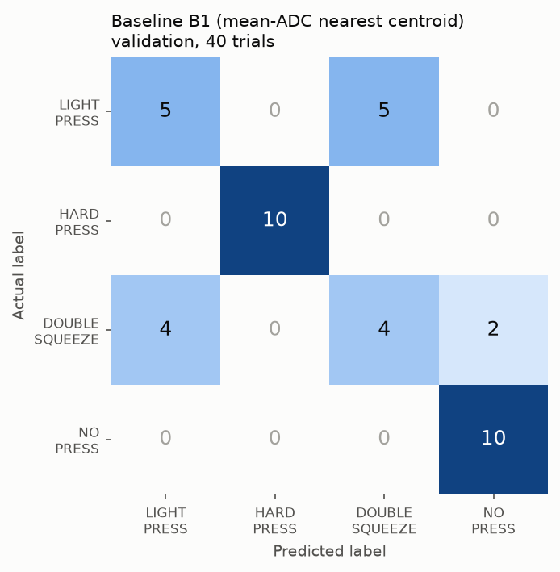

## 7. Feature engineering

49 features per trial, computed by `gripsense_features.extract_trial_features` from that
trial's 150 readings only. The function has no learned parameters, so it cannot leak statistics across
splits. The same function is used in `predict.py` for inference.

| Group | Features |
|---|---|
| Level statistics | mean, median, std, min, max, range, q10, q25, q75, q90, iqr, rms |
| Contact / zero | zero_fraction, longest_zero_run_frac, longest_active_run_frac, active_mean (mean of readings > 100) |
| Threshold fractions | above_{50, 100, 500, 1000, 1500, 2000}_fraction |
| Temporal events | press_events_100, press_events_300 (rising threshold crossings), peak_position_frac |
| Change between readings | mean_abs_diff, std_diff, max_rise, max_fall |
| Segment statistics | segment_0..9_mean, segment_0..9_max (10 x 300 ms windows) |

Per-trial feature table: `reports/trial_features.csv`.

## 8. Model training and validation

Every candidate was fitted on the 120 training trials. Validation scores (40 trials) and a 5-fold
stratified CV on the training set were used for comparison. Logistic regression standardises features
inside a pipeline, so the scaler is fitted on training data only.

**Selection rule (declared before fitting):** max val macro-F1 -> max train 5-fold CV macro-F1 -> min val log-loss -> simpler family -> candidate order.

| selection_rank | family | params | train_cv5_macro_f1_mean | val_accuracy | val_macro_f1 | val_log_loss |
|---|---|---|---|---|---|---|
| 1 | RandomForest | {"n_estimators": 300, "max_depth": null, "min_samples_leaf": 1, "max_features": "sqrt"} | 0.992 | 0.975 | 0.975 | 0.102 |
| 2 | RandomForest | {"n_estimators": 300, "max_depth": 6, "min_samples_leaf": 1, "max_features": "sqrt"} | 0.992 | 0.975 | 0.975 | 0.102 |
| 3 | RandomForest | {"n_estimators": 300, "max_depth": null, "min_samples_leaf": 3, "max_features": "sqrt"} | 0.992 | 0.975 | 0.975 | 0.107 |
| 4 | RandomForest | {"n_estimators": 300, "max_depth": 6, "min_samples_leaf": 3, "max_features": "sqrt"} | 0.992 | 0.975 | 0.975 | 0.107 |
| 5 | RandomForest | {"n_estimators": 300, "max_depth": null, "min_samples_leaf": 1, "max_features": 0.3} | 0.992 | 0.975 | 0.975 | 0.121 |
| 6 | RandomForest | {"n_estimators": 300, "max_depth": 6, "min_samples_leaf": 1, "max_features": 0.3} | 0.992 | 0.975 | 0.975 | 0.121 |
| 7 | RandomForest | {"n_estimators": 300, "max_depth": null, "min_samples_leaf": 3, "max_features": 0.3} | 0.992 | 0.975 | 0.975 | 0.122 |
| 8 | RandomForest | {"n_estimators": 300, "max_depth": 6, "min_samples_leaf": 3, "max_features": 0.3} | 0.992 | 0.975 | 0.975 | 0.122 |
| 9 | LogisticRegression | {"C": 1.0} | 0.992 | 0.975 | 0.975 | 0.139 |
| 10 | LogisticRegression | {"C": 0.1} | 0.992 | 0.975 | 0.975 | 0.145 |
| 11 | LogisticRegression | {"C": 10.0} | 0.992 | 0.975 | 0.975 | 0.199 |
| 12 | DecisionTree | {"max_depth": 2} | 0.983 | 0.975 | 0.975 | 0.901 |
| 13 | DecisionTree | {"max_depth": 3} | 0.983 | 0.975 | 0.975 | 0.901 |
| 14 | DecisionTree | {"max_depth": 4} | 0.983 | 0.975 | 0.975 | 0.901 |

**14 of 14 candidates
tied at the best validation macro-F1 (0.975).** With so many ties, the validation set (40 trials) cannot
meaningfully rank these models. The tie-breakers (training CV, then validation log-loss, then
simplicity) made the final choice.

- **Selected:** RandomForest `{"n_estimators": 300, "max_depth": null, "min_samples_leaf": 1, "max_features": "sqrt"}`. Validation accuracy 0.975,
  macro-F1 0.975, log-loss 0.102, train-CV macro-F1 0.992.
- **Best Random Forest:** `{"n_estimators": 300, "max_depth": null, "min_samples_leaf": 1, "max_features": "sqrt"}`. Validation accuracy 0.975, macro-F1
  0.975, log-loss 0.102, train-CV macro-F1 0.992.

Selected model, validation (95% Wilson CI for accuracy 0.871-0.996):

| Class | Meaning | Precision | Recall | F1 | Support |
|---|---|---|---|---|---|
| LIGHT_PRESS | Hungry | 1.000 | 0.900 | 0.947 | 10 |
| HARD_PRESS | Pain | 1.000 | 1.000 | 1.000 | 10 |
| DOUBLE_SQUEEZE | Washroom | 0.909 | 1.000 | 0.952 | 10 |
| NO_PRESS | Idle/resting | 1.000 | 1.000 | 1.000 | 10 |
| **macro avg** | | 0.977 | 0.975 | 0.975 | 40 |
| **weighted avg** | | 0.977 | 0.975 | 0.975 | 40 |

| Actual \ Predicted | LIGHT_PRESS | HARD_PRESS | DOUBLE_SQUEEZE | NO_PRESS |
|---|---|---|---|---|
| **LIGHT_PRESS** | 9 | 0 | 1 | 0 |
| **HARD_PRESS** | 0 | 10 | 0 | 0 |
| **DOUBLE_SQUEEZE** | 0 | 0 | 10 | 0 |
| **NO_PRESS** | 0 | 0 | 0 | 10 |

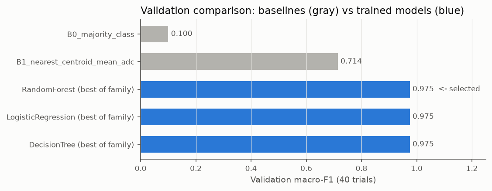

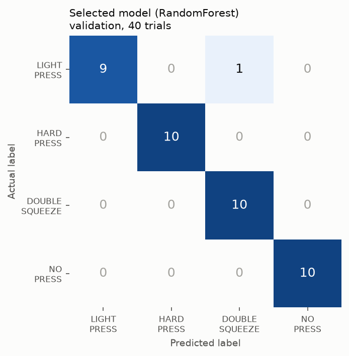

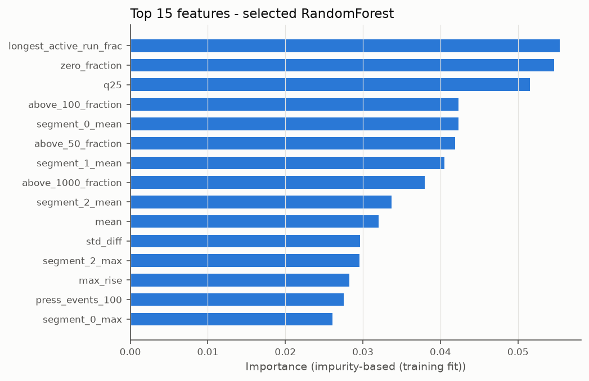

Feature importance (impurity-based (training fit)), top 10: `longest_active_run_frac` (0.055), `zero_fraction` (0.055), `q25` (0.052), `above_100_fraction` (0.042), `segment_0_mean` (0.042), `above_50_fraction` (0.042), `segment_1_mean` (0.040), `above_1000_fraction` (0.038), `segment_2_mean` (0.034), `mean` (0.032).

Validation misclassifications:

| trial | actual | predicted | confidence | audit_flags |
|---|---|---|---|---|
| 6 | LIGHT_PRESS | DOUBLE_SQUEEZE | 0.78 | atypical_std(z=+7.2); atypical_max(z=+7.3); atypical_zero_fraction(z=+6.3); atypical_mean_abs_diff(z=+6.7); dropout_to_zero_during_press(35%); light_press_peak_in_hard_range(max=1954) |

---

## 9. Final test results AFTER training (held-out, evaluated once)

The model was fitted on the 120 training trials and never saw the 40 test trials. It was saved to
`models/gripsense_model.joblib` before the test set was scored. No decision was changed after viewing these numbers.

**Accuracy: 0.975** (39/40 trials; 95% Wilson CI 0.871-0.996).

| Class | Meaning | Precision | Recall | F1 | Support |
|---|---|---|---|---|---|
| LIGHT_PRESS | Hungry | 1.000 | 0.900 | 0.947 | 10 |
| HARD_PRESS | Pain | 0.909 | 1.000 | 0.952 | 10 |
| DOUBLE_SQUEEZE | Washroom | 1.000 | 1.000 | 1.000 | 10 |
| NO_PRESS | Idle/resting | 1.000 | 1.000 | 1.000 | 10 |
| **macro avg** | | 0.977 | 0.975 | 0.975 | 40 |
| **weighted avg** | | 0.977 | 0.975 | 0.975 | 40 |

### Confusion matrix (test; rows = actual, columns = predicted)

| Actual \ Predicted | LIGHT_PRESS | HARD_PRESS | DOUBLE_SQUEEZE | NO_PRESS |
|---|---|---|---|---|
| **LIGHT_PRESS** | 9 | 1 | 0 | 0 |
| **HARD_PRESS** | 0 | 10 | 0 | 0 |
| **DOUBLE_SQUEEZE** | 0 | 0 | 10 | 0 |
| **NO_PRESS** | 0 | 0 | 0 | 10 |


### Misclassified test trials

| trial | actual | predicted | confidence | audit_flags |
|---|---|---|---|---|
| 39 | LIGHT_PRESS | HARD_PRESS | 0.83 | atypical_std(z=+3.9); atypical_max(z=+4.3); atypical_mean_abs_diff(z=+3.7) |

### Validation vs test

| Metric | Validation | Test |
|---|---|---|
| Accuracy | 0.975 | 0.975 |
| Macro F1 | 0.975 | 0.975 |
| Weighted F1 | 0.975 | 0.975 |
| Accuracy 95% CI | 0.871-0.996 | 0.871-0.996 |

| Class | Val F1 | Test F1 |
|---|---|---|
| LIGHT_PRESS | 0.947 | 0.947 |
| HARD_PRESS | 1.000 | 0.952 |
| DOUBLE_SQUEEZE | 0.952 | 1.000 |
| NO_PRESS | 1.000 | 1.000 |

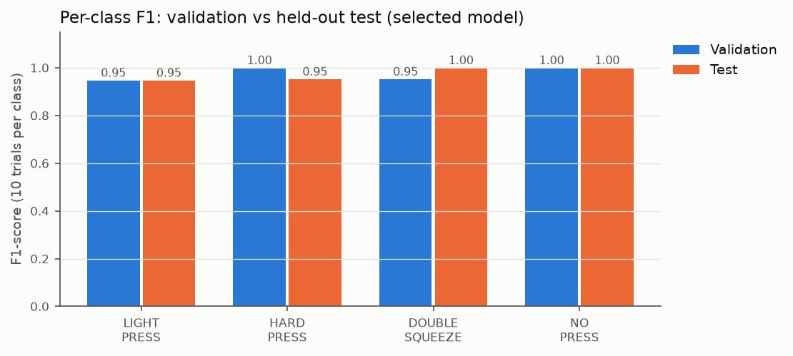

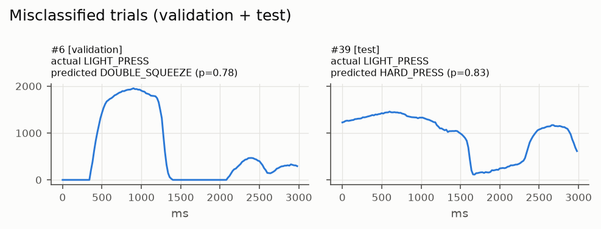

## 10. Error analysis

- Test accuracy differs from validation accuracy by +0.000. With 40 trials per split, one trial
  changes accuracy by 0.025, so differences of 1-2 trials are within noise.
- Test trials carrying an audit flag: 3, of which 1 were misclassified.
- Misclassified trials across validation + test: 2; of these, 2 were already flagged as
  atypical in the pre-training audit (#6 LIGHT_PRESS->DOUBLE_SQUEEZE [validation], #39 LIGHT_PRESS->HARD_PRESS [test]). The model's errors therefore fall on unusual
  recordings (e.g. LIGHT_PRESS trials with HARD-like peaks or dropouts) rather than on typical trials.
  On ~40 trials per split, this is an observation, not a guarantee.
- Lowest-confidence test predictions (the cases closest to the decision boundary):

| trial | actual | predicted | confidence | audit_flags |
|---|---|---|---|---|
| 157 | NO_PRESS | NO_PRESS | 0.5 | atypical_mean(z=+6.9); atypical_std(z=+7.0); atypical_max(z=+6.9); atypical_zero_fraction(z=-4.6); atypical_mean_abs_diff(z=+6.5); activity_during_no_press(max=704) |
| 111 | DOUBLE_SQUEEZE | DOUBLE_SQUEEZE | 0.5967 |  |
| 121 | DOUBLE_SQUEEZE | DOUBLE_SQUEEZE | 0.7433 |  |
| 39 | LIGHT_PRESS | HARD_PRESS | 0.83 | atypical_std(z=+3.9); atypical_max(z=+4.3); atypical_mean_abs_diff(z=+3.7) |
| 70 | HARD_PRESS | HARD_PRESS | 0.8433 |  |

- The confusable pair in this data is LIGHT_PRESS vs DOUBLE_SQUEEZE (similar mean force). The baseline B1
  confusion matrix shows this directly. The trained model separates them using temporal and zero-contact
  features (see feature importance). HARD_PRESS and NO_PRESS are separated by level alone.

## 11. Discussion

The per-trial features make the four gestures close to linearly separable **in this recording**.
Simple models (shallow tree, logistic regression) score as well as the Random Forest on validation. This is good
news for TinyML, because a tree of depth 2-4 or a 4x49 linear model fits easily on an ESP32,
while a 300-tree forest is much heavier. The jump from baseline B1 (0.725) to the trained model
(0.975) comes almost entirely from temporal and contact features that resolve LIGHT_PRESS vs DOUBLE_SQUEEZE.

Near-perfect scores call for scepticism rather than celebration. The recording-order confound
(Section 3.3) means part of the separability could come from session effects. That matters most for
classes whose definitions depend on absolute force level (LIGHT vs HARD), which also shift with sensor
placement and between users.

## 12. Limitations

1. **Small test set:** 10 trials per class (40 total). One error costs 2.5 accuracy points overall and
   10 recall points for that class. The 95% CI on test accuracy is 0.871-0.996. Per-class
   precision and recall have even wider uncertainty.
2. **Ceiling effects:** 14 of 14 candidates tie at the best validation score, so model selection is weakly
   informed. The validation-vs-test comparison cannot reveal small generalisation gaps.
3. **Recording-order / session confound:** classes were recorded in contiguous blocks. Random trial
   splits put trials from the same session in both train and test, which likely overstates performance.
4. **Probably one user, one sensor, one placement:** no cross-user or cross-day evaluation is possible.
5. **DOUBLE_SQUEEZE protocol mismatch:** training "double squeezes" are 3-7 repeated squeezes. Performance
   on a genuine single double squeeze is unknown and could be poor (it may look like LIGHT_PRESS).
6. **Scripted, segmented gestures:** each trial is a clean, pre-segmented 3-second window. Real use
   needs continuous segmentation, rejection of unintended grips, and robustness to long idle periods.
7. **Offline only:** the model has not been converted, quantised or timed on the ESP32.
8. **Safety:** HARD_PRESS means "Pain". A missed or false "Pain" signal has real consequences, so
   any deployment needs confirmation feedback and human oversight, whatever these metrics show.

## 13. Conclusion

On this dataset, a trial-level classifier on 49 hand-crafted FSR features clearly beats
both baselines. The selected RandomForest reached 0.975 validation accuracy and
**0.975 held-out test accuracy (39/40)**. The data pipeline is clean
and leakage-free at the trial level. The evidence supports "these four gestures are distinguishable
in this recording". It does not support "GripSense is reliable in real-world use".

## 14. Next steps

1. **Collect new data with interleaved/randomised class order** across several sessions, days and (ideally)
   users. Then evaluate with session- or user-grouped splits (leave-one-session-out).
2. Re-record DOUBLE_SQUEEZE as exactly two squeezes followed by rest, matching the intended gesture. Keep
   the current trials as a separate "repeated squeeze" condition if it is useful.
3. Record NO_PRESS with realistic distractors (hand resting on the sensor, accidental bumps), not only zeros.
4. Review the flagged trials (4, 6, 10, 38, 39, 45, 46, 53, 55, 60, 63, 64...) and confirm whether they were performed as instructed.
5. Port a compact model (depth-limited tree or logistic regression on a few features, e.g. via
   `micromlgen`/`m2cgen` or hand-written C). Verify on-device feature parity against `gripsense_features.py`,
   then measure latency and memory on the ESP32.
6. Add a sliding-window / onset detector for continuous streams, and a confidence threshold with an
   "uncertain - please repeat" output.

## 15. Reproducibility

- Seed: **42** (split, CV folds, models, figure sampling).
- Environment: Python 3.12.13, numpy 2.5.3, pandas 3.0.6, scikit-learn
  1.9.1, matplotlib 3.11.2, joblib 1.6.0 (macOS-27.0.1-arm64-arm-64bit).
- Input CSV SHA-256: `05e0fc031e28a2406bc2cbf7d35642e1064310fc03c499710c8f6796148c9ec8` (unchanged after run: True).
- Exact split counts: train 120 trials / 18,000 readings;
  validation 40 / 6,000; test 40 / 6,000;
  30/10/10 trials per class.
- Commands (from the project folder):

```bash
python3 -m venv .venv
.venv/bin/pip install -r requirements.txt
.venv/bin/python run_experiment.py --csv gripsense_clean_data.csv --seed 42
.venv/bin/python validate_outputs.py
.venv/bin/python predict.py --csv gripsense_clean_data.csv --trials 1 60 120 180
```

- Saved model reload check (predictions identical to in-memory model): True.

**Run history (disclosure).** The first full run of this script used the same split, features, candidate
grid and selection rule. It selected a Random Forest (`max_depth=None, min_samples_leaf=1, max_features="sqrt"`)
and scored 0.975 on validation and 0.975 on test (39/40; misclassified test trial 39). Afterwards, two
changes were made, prompted by the audit and a runtime warning (not by the test score):
(a) validation log-loss had used clipped probabilities that were not renormalised (tie-breaker only);
(b) the audit flag "DOUBLE_SQUEEZE must have exactly 2 presses" flagged all 50 trials, which was recognised
as a protocol finding (Section 3.3) and moved to a dataset-level check. Features, split and candidates were
not changed.

## Appendix: artifact index

| Path | Content |
|---|---|
| `reports/dataset_audit.csv` | data-quality checks |
| `reports/trial_quality_flags.csv` | per-trial robust z-scores and flags |
| `reports/trial_features.csv` | one row per trial: trial, label, split, 49 features |
| `reports/split_manifest.csv` | trial -> label -> split |
| `reports/pre_training_plan.md` | plan written before model fitting |
| `reports/metrics.json` | all measured metrics |
| `reports/figures/` | 14 figures |
| `models/gripsense_model.joblib`, `models/model_metadata.json` | model bundle + metadata |
| `results/` | predictions, selection table, baselines, classification reports, misclassified trials, feature importance |
