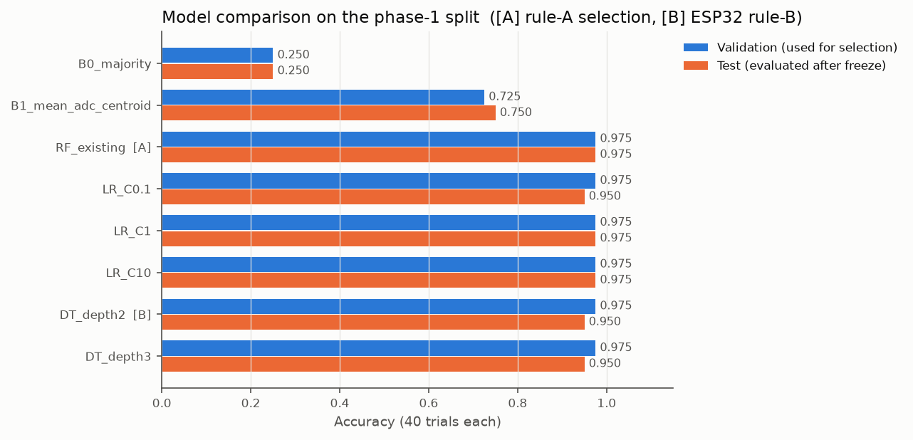
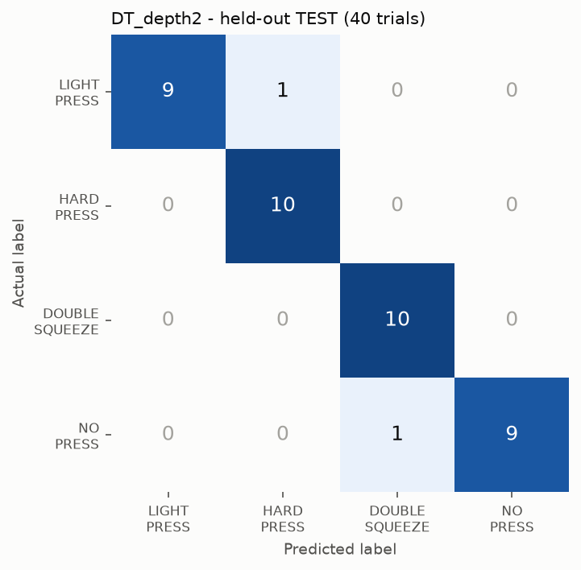
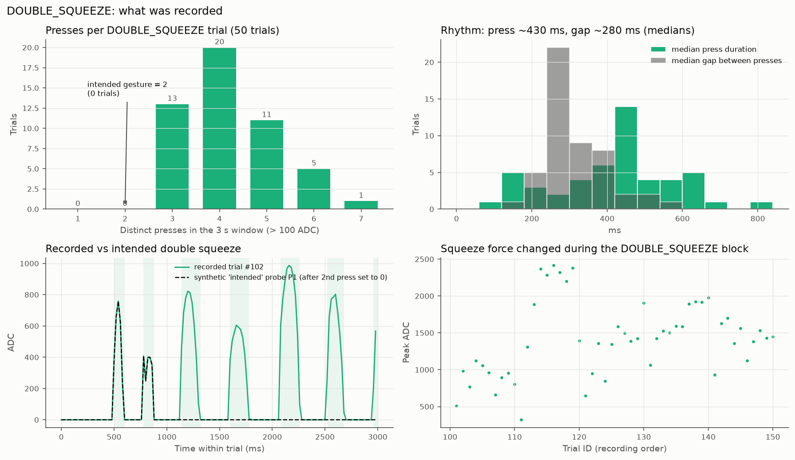
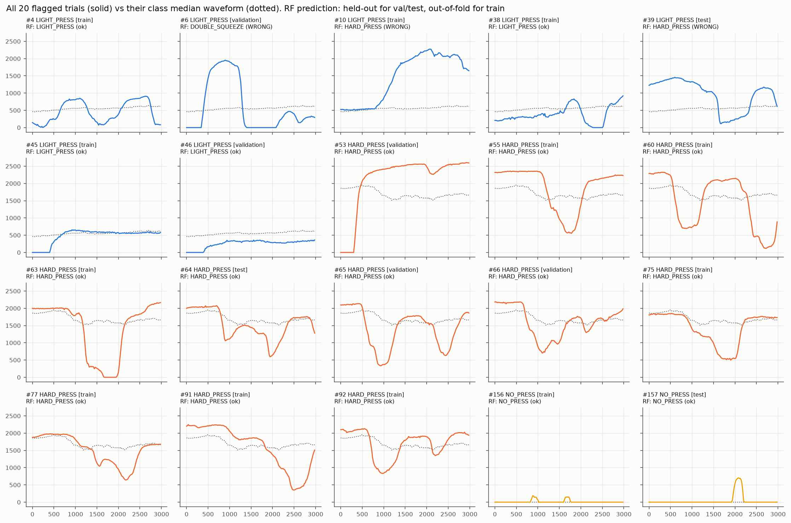
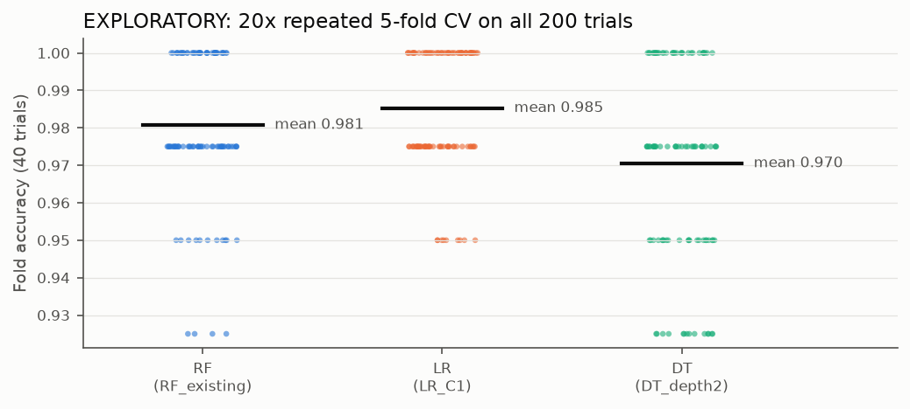
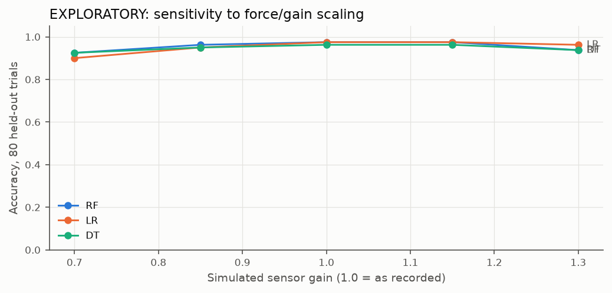
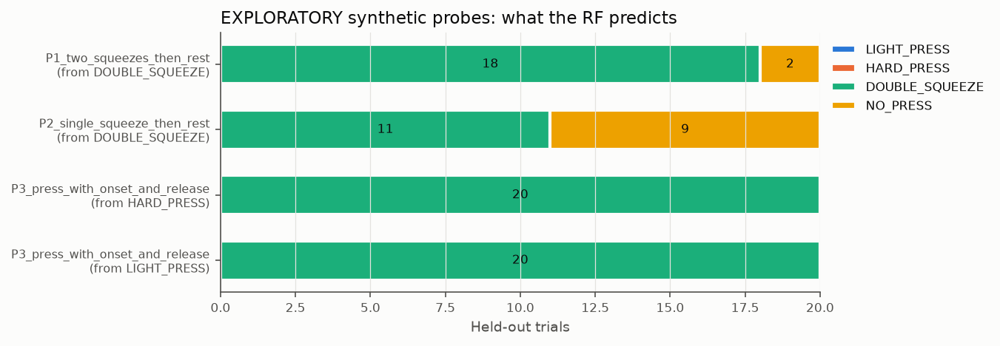
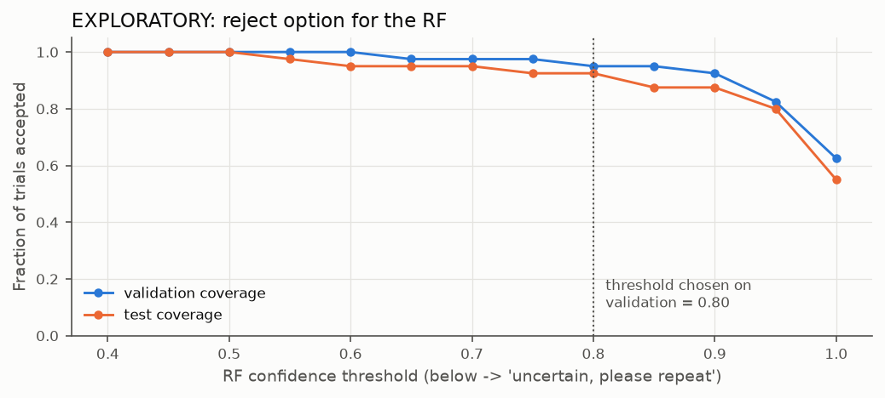

# GripSense TinyML - Final Report (phase 2 follow-up)

_Generated 2026-10-10T15:16:49+00:00 by `run_followup.py` (seed 42). All numbers are read from
`reports/followup/followup_metrics.json`, `results/followup/*.csv` and the phase-1 artifacts, and were
cross-checked by `validate_followup.py`. Phase-1 outputs (`reports/`, `results/`, `models/` top level) are
unchanged; their SHA-256 hashes were snapshotted before this work and re-verified afterwards._

> **No new data was collected and no hardware testing was performed.** Everything below comes from the
> existing `gripsense_clean_data.csv` (SHA-256 `05e0fc031e28a240...`), offline. The ESP32 was
> not connected. Exploratory analyses (Section 8) reuse or synthetically modify the same recordings
> and are **not** independent or real-world validation.

## Executive summary

- **Dataset (audited before training):** 30,000 readings, 200 trials x 150 samples at 20 ms, 50 trials per
  class, structurally clean (28 PASS checks). It has protocol limitations: classes were recorded
  in contiguous blocks; **no DOUBLE_SQUEEZE trial contains a double squeeze** ({3: 13, 4: 20, 5: 11, 6: 5, 7: 1}
  presses: trials); and 45/50 LIGHT_PRESS and 49/50 HARD_PRESS windows start mid-press.
- **Model comparison (same phase-1 split, 120/40/40 trials):** 6 of 6 trained candidates tie at validation macro-F1
  0.975. Baselines: majority 0.250, mean-ADC centroid 0.725 validation accuracy.
- **Rule A (primary, unchanged from phase 1) selects `RF_existing`.** Test accuracy **0.975**
  (39/40; 95% CI 0.871-0.996), macro-F1 **0.975**, misclassified [39].
- **Rule B (ESP32 size) selects `DT_depth2`** (7 nodes, ~84 bytes, 2 features vs RF ~30,672 bytes).
  Test accuracy **0.950** (38/40), macro-F1 **0.950**, misclassified [39, 157].
- **Uncertainty dominates.** With 10 test trials per class, a perfect 10/10 recall is consistent with a true recall as low as
  0.72 (95% Wilson). On the paired test set, no trained model differs significantly from the RF; only the two
  baselines are significantly worse (exact McNemar, p < 0.05).
- **Test-set history:** the phase-1 RF test result had already been inspected, so the test set is **not completely
  untouched** (Section 5.1).
- **Biggest practical risk (exploratory, synthetic probes):** the models are sensitive to how a press sits in the window.
  When LIGHT/HARD presses are edited to include a realistic onset and release (rest at both ends), the RF calls
  **40/40** of them DOUBLE_SQUEEZE. A *single* squeeze is also called DOUBLE_SQUEEZE ("Washroom") 11/20 times
  (tree: 17/20). "Two squeezes then rest" is recognised 18/20 times.

## 1. Objectives and scope

1. Re-use the phase-1 data, split, features and model, without changing trial assignments.
2. Compare the existing Random Forest with baselines, logistic regression and shallow decision trees, using train for
   fitting and validation for selection, and then evaluate on the held-out test set.
3. Quantify uncertainty, analyse errors, the 20 flagged trials and the DOUBLE_SQUEEZE protocol mismatch.
4. Run clearly labelled exploratory robustness analyses on the existing data.
5. Give practical ESP32 deployment recommendations, with no new data or hardware.

## 2. Dataset and quality audit (performed BEFORE training, phase 1)

The phase-1 audit (`reports/dataset_audit.csv`, unchanged) ran before any split or model fitting.
Integrity checks all passed: no missing values or duplicates, one label per trial, exactly 150 samples per
trial at 20 ms, ADC 0-2608 (no saturation), and 50 trials per class. Non-PASS items:

| check | observed | status |
|---|---|---|
| classes recorded in contiguous trial blocks | LIGHT_PRESS: 1-50; HARD_PRESS: 51-100; DOUBLE_SQUEEZE: 101-150; NO_PRESS: 151-200 | WARN |
| press events per trial: DOUBLE_SQUEEZE | {3: 13, 4: 20, 5: 11, 6: 5, 7: 1} | WARN |
| trials flagged for review (kept in dataset) | 20 | WARN |

Flagged trials (kept, not relabelled): 20 ({'HARD_PRESS': 11, 'LIGHT_PRESS': 7, 'NO_PRESS': 2}). Phase-1 report: `reports/GripSense_TinyML_Report.md`.

## 3. Split (unchanged from phase 1)

`reports/split_manifest.csv` was re-used without modification: train 120, validation
40, test 40 trials (30/10/10 per class; 18,000/6,000/6,000 readings), seed 42, stratified
by label at trial level. There is no trial overlap. All new models were fitted on the 120 training trials only
(trial IDs stored in `models/followup/followup_models_metadata.json`). The features were recomputed from the CSV and match
`reports/trial_features.csv` exactly. Trial ID is not a feature.

## 4. Existing baselines and model comparison (validation-based selection)

All candidates are fitted on train and scored on validation. `RF_existing` is the saved phase-1 model, used as-is; it
reproduces its phase-1 validation and test predictions exactly. Model sizes are **rough estimates** for flattened C
arrays (12 bytes per tree node, 4 bytes per float), not measurements on an ESP32.

| model | family | params | train_cv5_macro_f1 | val_accuracy | val_macro_f1 | val_log_loss | val_misclassified | footprint | est_bytes | n_features_used |
|---|---|---|---|---|---|---|---|---|---|---|
| B0_majority | Baseline | {} | 0.100 | 0.250 | 0.100 | 27.033 | [6, 9, 11, 22, 25, 30, 31, 43, 46, 47, 53, 56, 65, 66, 69, 71, 74, 83, 84, 100, 158, 162, 170, 174, 175, 177, 180, 183, 195, 197] | 1 label | 1 | 0 |
| B1_mean_adc_centroid | Baseline | {"feature": "mean"} | 0.612 | 0.725 | 0.714 | 0.451 | [11, 22, 31, 46, 47, 102, 116, 122, 136, 137, 142] | 4 floats | 16 | 1 |
| RF_existing | RandomForest | {"n_estimators": 300, "max_depth": null, "min_samples_leaf": 1, "max_features": "sqrt"} | 0.992 | 0.975 | 0.975 | 0.102 | [6] | 2556 nodes | 30672 | 47 |
| LR_C0.1 | LogisticRegression | {"C": 0.1} | 0.992 | 0.975 | 0.975 | 0.145 | [6] | 298 float params | 1192 | 49 |
| LR_C1 | LogisticRegression | {"C": 1.0} | 0.992 | 0.975 | 0.975 | 0.139 | [6] | 298 float params | 1192 | 49 |
| LR_C10 | LogisticRegression | {"C": 10.0} | 0.992 | 0.975 | 0.975 | 0.199 | [6] | 298 float params | 1192 | 49 |
| DT_depth2 | DecisionTree | {"max_depth": 2} | 0.983 | 0.975 | 0.975 | 0.901 | [6] | 7 nodes | 84 | 2 |
| DT_depth3 | DecisionTree | {"max_depth": 3} | 0.983 | 0.975 | 0.975 | 0.901 | [6] | 7 nodes | 84 | 2 |

**Pre-declared selection rules** (frozen in `results/followup/selection_freeze.json` before any test prediction in this phase):
- **Rule A (primary):** max validation macro-F1 -> max train 5-fold CV macro-F1 -> min validation log-loss -> simpler
  family. This is identical to phase 1. -> **`RF_existing`**
- **Rule B (ESP32 deployment):** among models tied at the best validation macro-F1, the smallest estimated size -> train
  CV -> log-loss. -> **`DT_depth2`**
- Disclosure: Rule B was written after the phase-1 validation table (all candidates tied) had been seen, but before any
  test prediction of the logistic-regression or decision-tree candidates.

Every trained candidate makes the same validation error(s): trials [6]. Validation therefore cannot rank the trained models. It only shows that they all clearly beat both
baselines.



## 5. Final held-out test results

### 5.1 Test-set history (disclosure)

Phase 1 already computed and reported RF_existing test results (39/40, trial 39 misclassified); the phase-1 run history also discloses a rerun after the test score was seen. The test set is therefore NOT completely untouched. In phase 2, selection rules were frozen (selection_freeze.json) before any test prediction of the new candidates. run_followup.py was executed more than once while the report text was being corrected; between runs only report wording changed - the split, candidates, selection rules and selected models were identical in every run.

### 5.2 Rule-A model: `RF_existing` (primary)

**Accuracy 0.975** (39/40; Wilson 95% CI 0.871-0.996);
macro-F1 0.975 (bootstrap 95% CI 0.908-1.000).

| Class | Meaning | Precision | Recall | F1 | Support |
|---|---|---|---|---|---|
| LIGHT_PRESS | Hungry | 1.000 | 0.900 | 0.947 | 10 |
| HARD_PRESS | Pain | 0.909 | 1.000 | 0.952 | 10 |
| DOUBLE_SQUEEZE | Washroom | 1.000 | 1.000 | 1.000 | 10 |
| NO_PRESS | Idle/resting | 1.000 | 1.000 | 1.000 | 10 |
| **macro avg** | | 0.977 | 0.975 | 0.975 | 40 |
| **weighted avg** | | 0.977 | 0.975 | 0.975 | 40 |

| Actual \ Predicted | LIGHT_PRESS | HARD_PRESS | DOUBLE_SQUEEZE | NO_PRESS |
|---|---|---|---|---|
| **LIGHT_PRESS** | 9 | 1 | 0 | 0 |
| **HARD_PRESS** | 0 | 10 | 0 | 0 |
| **DOUBLE_SQUEEZE** | 0 | 0 | 10 | 0 |
| **NO_PRESS** | 0 | 0 | 0 | 10 |

Misclassified test trials: [39]. Validation: [6].


### 5.3 Rule-B model: `DT_depth2` (ESP32 deployment candidate)

**Accuracy 0.950** (38/40; Wilson 95% CI 0.835-0.986);
macro-F1 0.950 (bootstrap 95% CI 0.859-1.000).

| Class | Meaning | Precision | Recall | F1 | Support |
|---|---|---|---|---|---|
| LIGHT_PRESS | Hungry | 1.000 | 0.900 | 0.947 | 10 |
| HARD_PRESS | Pain | 0.909 | 1.000 | 0.952 | 10 |
| DOUBLE_SQUEEZE | Washroom | 0.909 | 1.000 | 0.952 | 10 |
| NO_PRESS | Idle/resting | 1.000 | 0.900 | 0.947 | 10 |
| **macro avg** | | 0.955 | 0.950 | 0.950 | 40 |
| **weighted avg** | | 0.955 | 0.950 | 0.950 | 40 |

| Actual \ Predicted | LIGHT_PRESS | HARD_PRESS | DOUBLE_SQUEEZE | NO_PRESS |
|---|---|---|---|---|
| **LIGHT_PRESS** | 9 | 1 | 0 | 0 |
| **HARD_PRESS** | 0 | 10 | 0 | 0 |
| **DOUBLE_SQUEEZE** | 0 | 0 | 10 | 0 |
| **NO_PRESS** | 0 | 0 | 1 | 9 |

Misclassified test trials: [39, 157]. Validation: [6].



Decision rules of `DT_depth2` (the whole model):

```
|--- longest_active_run_frac <= 0.353
|   |--- longest_active_run_frac <= 0.047
|   |   |--- class: NO_PRESS
|   |--- longest_active_run_frac >  0.047
|   |   |--- class: DOUBLE_SQUEEZE
|--- longest_active_run_frac >  0.353
|   |--- segment_1_mean <= 840.633
|   |   |--- class: LIGHT_PRESS
|   |--- segment_1_mean >  840.633
|   |   |--- class: HARD_PRESS
```

### 5.4 All candidates on test (secondary; NOT used for selection)

| model | test_accuracy | test_macro_f1 | test_errors | test_misclassified | acc_95ci_wilson | macro_f1_bootstrap_95ci |
|---|---|---|---|---|---|---|
| B0_majority | 0.250 | 0.100 | 30 | [5, 8, 17, 28, 33, 35, 39, 41, 42, 48, 52, 57, 58, 59, 64, 70, 76, 78, 85, 94, 152, 157, 163, 165, 172, 178, 179, 182, 186, 193] | 0.142-0.402 | 0.056-0.143 |
| B1_mean_adc_centroid | 0.750 | 0.734 | 10 | [8, 17, 35, 48, 111, 115, 119, 121, 139, 143] | 0.598-0.858 | 0.603-0.857 |
| RF_existing | 0.975 | 0.975 | 1 | [39] | 0.871-0.996 | 0.908-1.000 |
| LR_C0.1 | 0.950 | 0.950 | 2 | [39, 111] | 0.835-0.986 | 0.868-1.000 |
| LR_C1 | 0.975 | 0.975 | 1 | [39] | 0.871-0.996 | 0.908-1.000 |
| LR_C10 | 0.975 | 0.975 | 1 | [39] | 0.871-0.996 | 0.908-1.000 |
| DT_depth2 | 0.950 | 0.950 | 2 | [39, 157] | 0.835-0.986 | 0.859-1.000 |
| DT_depth3 | 0.950 | 0.950 | 2 | [39, 157] | 0.835-0.986 | 0.859-1.000 |

## 6. Error analysis and uncertainty

**Recall uncertainty for `RF_existing` (test, 10 trials per class):**

| Class | Recall | 95% Wilson CI |
|---|---|---|
| LIGHT_PRESS | 0.900 | 0.596-0.982 |
| HARD_PRESS | 1.000 | 0.722-1.000 |
| DOUBLE_SQUEEZE | 1.000 | 0.722-1.000 |
| NO_PRESS | 1.000 | 0.722-1.000 |

- With n = 10, 10/10 correct gives a 95% lower bound of 0.722, and 9/10 gives 0.596. One trial moves
  per-class recall by 0.10 and overall accuracy by 0.025.
- Paired comparisons against `RF_existing` on the same 40 test trials:

| Comparison (test, paired) | only first correct | only second correct | exact p |
|---|---|---|---|
| RF_existing vs B0_majority | 29 | 0 | 3.73e-09 |
| RF_existing vs B1_mean_adc_centroid | 10 | 1 | 0.0117 |
| RF_existing vs LR_C0.1 | 1 | 0 | 1 |
| RF_existing vs LR_C1 | 0 | 0 | 1 |
| RF_existing vs LR_C10 | 0 | 0 | 1 |
| RF_existing vs DT_depth2 | 1 | 0 | 1 |
| RF_existing vs DT_depth3 | 1 | 0 | 1 |

  Significantly different from `RF_existing` (p < 0.05): B0_majority, B1_mean_adc_centroid. Not significantly different:
  LR_C0.1, LR_C1, LR_C10, DT_depth2, DT_depth3. With 40 paired trials, differences of 1-2 trials cannot be distinguished from chance.
- **Where errors fall.** Distinct trials misclassified by any trained model (validation or test): #6 LIGHT_PRESS (flagged), #39 LIGHT_PRESS (flagged), #111 DOUBLE_SQUEEZE (not flagged), #157 NO_PRESS (flagged).
  3 of 4 were flagged by the pre-training audit. The test error shared by every trained model is #39,
  an atypically variable LIGHT_PRESS predicted as HARD_PRESS. For this application that is a **false "Pain"** signal.
- Held-out accuracy split by audit flag (exploratory, val+test pooled):

| model | audit_flagged | correct | trials | accuracy |
|---|---|---|---|---|
| DT_depth2 | False | 72 | 72 | 1.000 |
| DT_depth2 | True | 5 | 8 | 0.625 |
| LR_C1 | False | 72 | 72 | 1.000 |
| LR_C1 | True | 6 | 8 | 0.750 |
| RF_existing | False | 72 | 72 | 1.000 |
| RF_existing | True | 6 | 8 | 0.750 |

## 7. Dataset protocol limitations

### 7.1 DOUBLE_SQUEEZE does not match the intended gesture

The intended "Washroom" gesture is two squeezes followed by rest. The recordings show something else:

| Property (50 DOUBLE_SQUEEZE trials) | Measured |
|---|---|
| Presses per 3 s window (> 100 ADC) | {3: 13, 4: 20, 5: 11, 6: 5, 7: 1} (presses: trials) |
| Trials with exactly 2 presses | **0** |
| Median press duration / gap | 430 ms / 280 ms |
| Median press rate | 1.33 presses per second |
| Rest after the 2nd press (median / max) | 280 ms / 580 ms |
| Trials with >= 1 s rest after the 2nd press | 0 |
| Window starts / ends mid-press | 11 / 31 trials |
| Peak ADC vs recording order (Spearman rho, p) | +0.38, p = 0.00716 |
| Press count vs recording order (Spearman rho, p) | -0.21, p = 0.141 |

The recordings are continuous rhythmic squeezing (~1.3 Hz) that fills the window and is
often cut off at the window edges. They are not one discrete double squeeze. Peak squeeze force rises over the recording block (Spearman rho +0.38, p = 0.00716); press count shows no significant trend (rho -0.21, p = 0.141). The label is internally consistent, so I did **not** relabel or remove anything.
The class should be read as "repeated squeezing". A real double squeeze is not represented in the training data. Probe P1 (Section 8) suggests the models still
mostly accept it, but probe P2 shows they also accept a single squeeze, so the class is not specific to "two".



### 7.2 LIGHT_PRESS / HARD_PRESS windows start mid-press

45/50 LIGHT_PRESS and 49/50 HARD_PRESS trials are already above 100 ADC at t = 0, and
48/50 and 50/50 are still pressed at the end. The windows capture a steady hold, not the
approach, onset and release of a real press. On a device that triggers on onset, the window will contain rest + ramp-up,
which differs from the training data (probe P3).

### 7.3 Other limitations

- **Recording-order confound:** each class is one contiguous block of trials, so session drift is aligned with the label.
  A random trial split cannot separate gesture from session (exploratory E2 gives a partial view).
- **Probably one participant, one sensor placement, one session per class.** No cross-user or cross-day data exists.
- **NO_PRESS is almost entirely exact zeros.** Zero/contact features are among the top RF importances. In E3a, constant
  floor offsets of +10/+30 ADC (below the 100-ADC "pressed" threshold) changed accuracy only slightly. Offsets near or above
  100 ADC, or a drifting floor, were not tested.
- **Nominal timestamps** (always 20 ms), so sampling jitter is unknown.

### 7.4 The 20 flagged trials (inspected, kept)

| trial | label | split | pattern | peak_adc | zero_fraction | n_presses | closest_class_median_waveform | rf_prediction | prediction_source |
|---|---|---|---|---|---|---|---|---|---|
| 4 | LIGHT_PRESS | train | force less steady than typical LIGHT_PRESS (larger fluctuations) | 909 | 0.0 | 4 | LIGHT_PRESS | LIGHT_PRESS | out-of-fold (5-fold CV within train) |
| 6 | LIGHT_PRESS | validation | brief peak into HARD_PRESS force range | 1954 | 0.353 | 2 | LIGHT_PRESS | DOUBLE_SQUEEZE | held-out validation |
| 10 | LIGHT_PRESS | train | brief peak into HARD_PRESS force range | 2273 | 0.0 | 1 | HARD_PRESS | HARD_PRESS | out-of-fold (5-fold CV within train) |
| 38 | LIGHT_PRESS | train | force less steady than typical LIGHT_PRESS (larger fluctuations) | 919 | 0.073 | 2 | LIGHT_PRESS | LIGHT_PRESS | out-of-fold (5-fold CV within train) |
| 39 | LIGHT_PRESS | test | force less steady than typical LIGHT_PRESS (larger fluctuations) | 1457 | 0.0 | 1 | LIGHT_PRESS | HARD_PRESS | held-out test |
| 45 | LIGHT_PRESS | train | contact lost / released during the window | 656 | 0.14 | 1 | LIGHT_PRESS | LIGHT_PRESS | out-of-fold (5-fold CV within train) |
| 46 | LIGHT_PRESS | validation | contact lost / released during the window | 361 | 0.133 | 1 | DOUBLE_SQUEEZE | LIGHT_PRESS | held-out validation |
| 53 | HARD_PRESS | validation | released to zero during the window | 2606 | 0.107 | 1 | HARD_PRESS | HARD_PRESS | held-out validation |
| 55 | HARD_PRESS | train | force not held steady (dips 77% below its peak) | 2358 | 0.0 | 1 | HARD_PRESS | HARD_PRESS | out-of-fold (5-fold CV within train) |
| 60 | HARD_PRESS | train | force not held steady (dips 95% below its peak) | 2325 | 0.0 | 1 | HARD_PRESS | HARD_PRESS | out-of-fold (5-fold CV within train) |
| 63 | HARD_PRESS | train | released to zero during the window | 2165 | 0.093 | 2 | HARD_PRESS | HARD_PRESS | out-of-fold (5-fold CV within train) |
| 64 | HARD_PRESS | test | force not held steady (dips 71% below its peak) | 2076 | 0.0 | 1 | HARD_PRESS | HARD_PRESS | held-out test |
| 65 | HARD_PRESS | validation | force not held steady (dips 84% below its peak) | 2134 | 0.0 | 1 | HARD_PRESS | HARD_PRESS | held-out validation |
| 66 | HARD_PRESS | validation | force not held steady (dips 68% below its peak) | 2187 | 0.0 | 1 | HARD_PRESS | HARD_PRESS | held-out validation |
| 75 | HARD_PRESS | train | force not held steady (dips 73% below its peak) | 1852 | 0.0 | 1 | HARD_PRESS | HARD_PRESS | out-of-fold (5-fold CV within train) |
| 77 | HARD_PRESS | train | force not held steady (dips 67% below its peak) | 1981 | 0.0 | 1 | HARD_PRESS | HARD_PRESS | out-of-fold (5-fold CV within train) |
| 91 | HARD_PRESS | train | force not held steady (dips 84% below its peak) | 2247 | 0.0 | 1 | HARD_PRESS | HARD_PRESS | out-of-fold (5-fold CV within train) |
| 92 | HARD_PRESS | train | force not held steady (dips 61% below its peak) | 2128 | 0.0 | 1 | HARD_PRESS | HARD_PRESS | out-of-fold (5-fold CV within train) |
| 156 | NO_PRESS | train | brief unintended contact (peak 186 ADC) during rest | 186 | 0.887 | 2 | NO_PRESS | NO_PRESS | out-of-fold (5-fold CV within train) |
| 157 | NO_PRESS | test | brief unintended contact (peak 704 ADC) during rest | 704 | 0.907 | 1 | NO_PRESS | NO_PRESS | held-out test |

RF correct on 17/20 flagged trials (held-out predictions for val/test; 5-fold
out-of-fold predictions within the training set for train trials; out-of-fold accuracy on all 120 training trials:
0.992). "Closest class median waveform" is the class whose median
waveform has the smallest mean squared distance to the trial. It is a hint, not a relabelling.



## 8. EXPLORATORY robustness analyses (not independent validation)

These analyses re-use the same 200 recordings (from one participant/session context) and, for E3, synthetically modify
them. They help find weaknesses. They do **not** measure real-world accuracy. E1 and E2 pool test trials into
training folds and were run after the final test evaluation, so they had no influence on selection.

**E1 - Repeated 5-fold CV on all 200 trials (20 repeats; fixed hyperparameters).**

| Model | Folds | Mean acc | Std | 5th pct | Min |
|---|---|---|---|---|---|
| RF (RF_existing) | 100 | 0.981 | 0.020 | 0.950 | 0.925 |
| LR (LR_C1) | 100 | 0.985 | 0.016 | 0.950 | 0.950 |
| DT (DT_depth2) | 100 | 0.970 | 0.026 | 0.925 | 0.925 |



**E2 - Chronological within-class split (drift proxy).** Train on the earliest 30 trials of each class and test on the
latest 20, and the reverse.

| Direction | Model | Train / test trials | Accuracy | Macro-F1 | Misclassified |
|---|---|---|---|---|---|
| early->late | RF | 120 / 80 | 0.988 | 0.987 | [39] |
| early->late | LR | 120 / 80 | 0.988 | 0.987 | [39] |
| early->late | DT | 120 / 80 | 0.988 | 0.987 | [39] |
| late->early | RF | 120 / 80 | 0.975 | 0.975 | [6, 10] |
| late->early | LR | 120 / 80 | 0.975 | 0.975 | [6, 10] |
| late->early | DT | 120 / 80 | 0.938 | 0.937 | [6, 10, 101, 111, 157] |

Accuracy stays within a few trials of the random split in both directions, so drift *within* a class block has little
effect on these features. This cannot test the more important *between-class* confound (each class is its own block).

**E3a - Signal perturbations on the 80 held-out (val+test) trials, using models trained on the training split.** Gain =
multiply ADC (sensitivity/placement change); noise only while pressed; floor offset = add a constant to every reading
(sensor no longer reads exactly 0 at rest).

| perturbation | value | RF | LR | DT |
|---|---|---|---|---|
| floor_offset | 10.0 | 0.963 | 0.963 | 0.963 |
| floor_offset | 30.0 | 0.963 | 0.963 | 0.963 |
| gain | 0.7 | 0.925 | 0.900 | 0.925 |
| gain | 0.85 | 0.963 | 0.950 | 0.950 |
| gain | 1.0 | 0.975 | 0.975 | 0.963 |
| gain | 1.15 | 0.975 | 0.975 | 0.963 |
| gain | 1.3 | 0.938 | 0.963 | 0.938 |
| noise_while_pressed_sd | 25.0 | 0.975 | 0.975 | 0.963 |
| noise_while_pressed_sd | 50.0 | 0.975 | 0.950 | 0.950 |

RF accuracy at gain 0.7 / 1.3: 0.925 / 0.938. With a floor offset of +10 / +30 ADC:
RF 0.963 / 0.963, DT 0.963 / 0.963.



**E3b - Synthetic gesture probes (held-out trials).** P1: DOUBLE_SQUEEZE trials with everything after the 2nd press set to
0, approximating the intended gesture. P2: the same with only the 1st press kept. P3: LIGHT/HARD trials with the first and
last 500 ms set to 0, approximating onset and release. These are crude edits of real signals, not new recordings.

| probe | model | original_label | LIGHT_PRESS | HARD_PRESS | DOUBLE_SQUEEZE | NO_PRESS |
|---|---|---|---|---|---|---|
| P1_two_squeezes_then_rest | DT | DOUBLE_SQUEEZE | 0 | 0 | 19 | 1 |
| P1_two_squeezes_then_rest | LR | DOUBLE_SQUEEZE | 0 | 0 | 18 | 2 |
| P1_two_squeezes_then_rest | RF | DOUBLE_SQUEEZE | 0 | 0 | 18 | 2 |
| P2_single_squeeze_then_rest | DT | DOUBLE_SQUEEZE | 0 | 0 | 17 | 3 |
| P2_single_squeeze_then_rest | LR | DOUBLE_SQUEEZE | 0 | 0 | 10 | 10 |
| P2_single_squeeze_then_rest | RF | DOUBLE_SQUEEZE | 0 | 0 | 11 | 9 |
| P3_press_with_onset_and_release | DT | HARD_PRESS | 20 | 0 | 0 | 0 |
| P3_press_with_onset_and_release | DT | LIGHT_PRESS | 18 | 0 | 2 | 0 |
| P3_press_with_onset_and_release | LR | HARD_PRESS | 0 | 0 | 20 | 0 |
| P3_press_with_onset_and_release | LR | LIGHT_PRESS | 5 | 0 | 15 | 0 |
| P3_press_with_onset_and_release | RF | HARD_PRESS | 0 | 0 | 20 | 0 |
| P3_press_with_onset_and_release | RF | LIGHT_PRESS | 0 | 0 | 20 | 0 |

Interpretation (RF unless stated):
- P1 "two squeezes then rest" -> DOUBLE_SQUEEZE 18/20.
- P2 single squeeze -> DOUBLE_SQUEEZE x11, NO_PRESS x9. There is no "single squeeze" class, so roughly half
  are called "Washroom".
- P3 LIGHT/HARD with onset and release -> RF: DOUBLE_SQUEEZE x40; LR: LIGHT_PRESS x5, DOUBLE_SQUEEZE x35;
  DT: LIGHT_PRESS x38, DOUBLE_SQUEEZE x2. Any rest inside the window looks like the gaps of
  DOUBLE_SQUEEZE to the RF/LR. The tree instead misreads HARD as LIGHT, because its force split uses `segment_1_mean`
  (300-600 ms), which this probe sets to rest. P3 is a crude edit (instant steps to 0), so the size of the effect is uncertain,
  but its direction is a clear warning about window alignment.



**E4 - Reject option for the RF (threshold chosen on validation).** Smallest threshold with zero accepted validation
errors: **0.80** (validation coverage 0.950). On test it accepts
0.925 of trials with accepted accuracy 0.973 (1 accepted errors).
Accepted test errors at this threshold: #39 LIGHT_PRESS->HARD_PRESS (confidence 0.83). A confidence threshold alone does not reliably catch the false-"Pain" case.

| threshold | accepted_accuracy_test | accepted_accuracy_validation | coverage_test | coverage_validation |
|---|---|---|---|---|
| 0.400 | 0.975 | 0.975 | 1.000 | 1.000 |
| 0.450 | 0.975 | 0.975 | 1.000 | 1.000 |
| 0.500 | 0.975 | 0.975 | 1.000 | 1.000 |
| 0.550 | 0.974 | 0.975 | 0.975 | 1.000 |
| 0.600 | 0.974 | 0.975 | 0.950 | 1.000 |
| 0.650 | 0.974 | 0.974 | 0.950 | 0.975 |
| 0.700 | 0.974 | 0.974 | 0.950 | 0.975 |
| 0.750 | 0.973 | 0.974 | 0.925 | 0.975 |
| 0.800 | 0.973 | 1.000 | 0.925 | 0.950 |
| 0.850 | 1.000 | 1.000 | 0.875 | 0.950 |
| 0.900 | 1.000 | 1.000 | 0.875 | 0.925 |
| 0.950 | 1.000 | 1.000 | 0.800 | 0.825 |
| 1.000 | 1.000 | 1.000 | 0.550 | 0.625 |



## 9. Practical ESP32 deployment recommendations

1. **Model choice.** On this data the DT_depth2 (~84 bytes, 2 features) and
   LR_C1 (~1,192 bytes, all 49 features) match the RF on validation. The 300-tree RF (~30,672 bytes
   estimated) is far larger for no measured gain. The tree uses only longest_active_run_frac, segment_1_mean. Its LIGHT/HARD decision depends
   on the mean force in a fixed 300-600 ms slice of the window, so it is only valid if device windows are aligned like
   the training windows (probe P3). Logistic regression gives smoother confidence scores but needs all 49 features.
2. **Feature parity.** Port only the features the chosen model uses, and unit-test the C implementation against
   `reports/trial_features.csv` (same 150-sample inputs, outputs within a tolerance) before trusting on-device results.
3. **Buffering and timing.** 150 x uint16 = 300 bytes per window at 50 Hz (20 ms timer-driven sampling, not `delay()`).
   Classify on a sliding window (e.g. every 0.5 s), or after an onset trigger plus 3 s.
4. **Onset/segmentation (most important).** Training windows start mid-press (Section 7.2). Probe P3 shows that adding
   rest at the window edges flips the RF's LIGHT/HARD predictions to DOUBLE_SQUEEZE. On the device, classify only windows that
   resemble training conditions (e.g. start classifying once force has been above threshold for ~0.5 s), and require
   two consecutive identical predictions before acting.
5. **Reject option.** Output "uncertain - please repeat" below a confidence threshold. On this data the RF threshold
   chosen on validation was 0.80. Re-tune it on device data before relying on it.
6. **Safety for "Pain".** The observed failure mode is LIGHT -> HARD (false Pain). Use an explicit confirmation (LED/
   vibration + repeat or hold) before sending an alert, and never make the device the only channel for pain reporting.
7. **DOUBLE_SQUEEZE.** The model's "Washroom" class means "intermittent squeezing", and it also fires on a single squeeze
   (probe P2). Either instruct users to "squeeze repeatedly" (matching the data), or decide this class with an explicit
   rule-based press counter (e.g. exactly two presses within ~1.5 s, then rest) instead of the classifier.
8. **Calibration.** Force-level classes shift with gain (E3a). Fix the ADC attenuation/width (e.g. 11 dB, 12-bit) and the
   divider resistor exactly as used during recording, and consider a per-user calibration step that scales readings.

## 10. Conclusion

On the existing split, all trained models (RF, logistic regression, depth-2/3 trees) reach the same validation score
(0.975 macro-F1) and clearly beat the baselines. On the held-out test set, the rule-A RF scores
0.975 and the rule-B tree 0.950. The test set was already partly inspected in
phase 1, and with 10 trials per class these numbers carry wide uncertainty. The main obstacles to deployment are not model
accuracy but **data protocol**: DOUBLE_SQUEEZE is "repeated squeezing", presses are captured mid-hold, classes are confounded
with recording session, there is probably one user, and synthetic probes show strong sensitivity to window alignment. These results show that the classes are separable in this recording.
They do not show real-world reliability.

## 11. Recommended next software-only step

Port `gripsense_features.py` (only the features `DT_depth2` uses, plus the press counter) and the DT_depth2 rules to
plain C. Then build a host-side parity test, compiled with the Mac's `cc`, that feeds all 200 recorded trials from the CSV
through the C code and checks that the features and predictions exactly match `reports/trial_features.csv` and the Python
model. This needs no hardware and de-risks the eventual ESP32 port.

## 12. Reproducibility

```bash
cd "/Users/zenith/Desktop/GripSense-TinyML "
.venv/bin/python run_followup.py
.venv/bin/python validate_followup.py
```

Seed 42; Python 3.12.13, numpy 2.5.3, pandas 3.0.6,
scikit-learn 1.9.1, scipy 1.18.1, matplotlib 3.11.2.
Selection-freeze SHA-256: `15bdbea7b420f6bb3bcf8dc967f643d51a2ff1004ee38e8fa61192bef29caad3`.

Artifacts: `reports/followup/` (this report, metrics, figures, validation checks), `results/followup/` (comparison,
predictions for every model/split, freeze file, protocol and exploratory tables), `models/followup/` (fitted
comparison models, tree rules, metadata).
