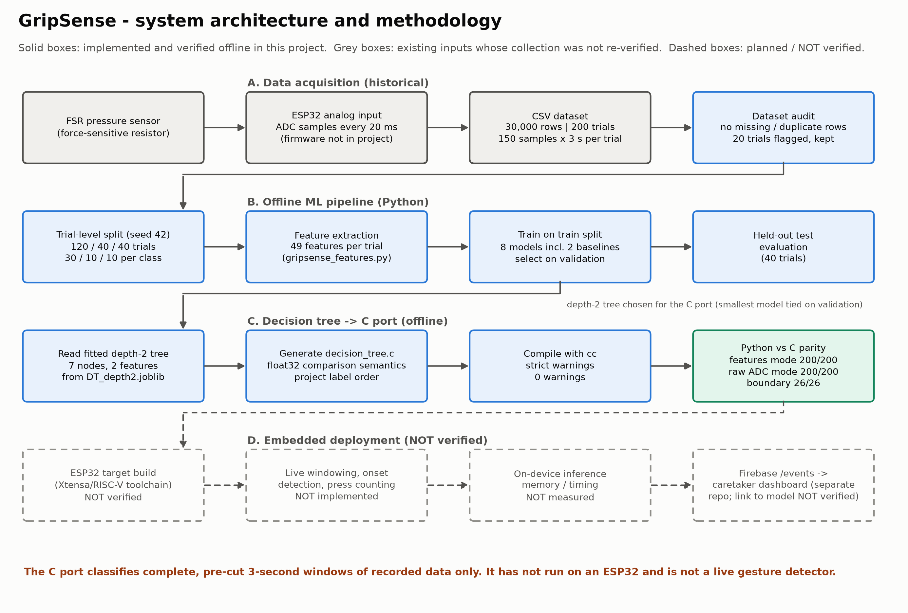
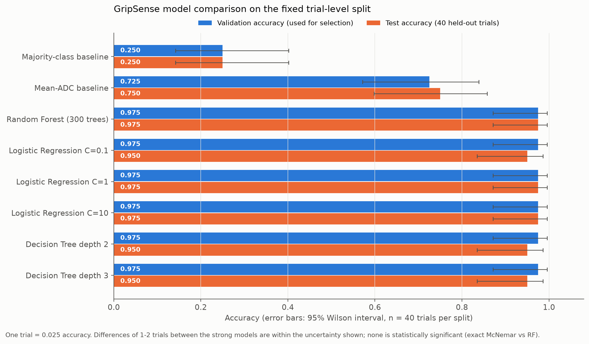
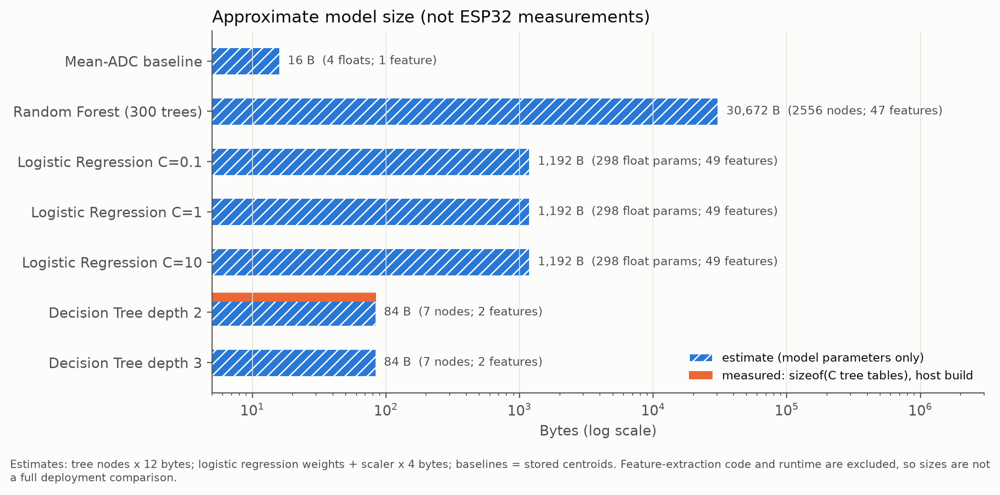
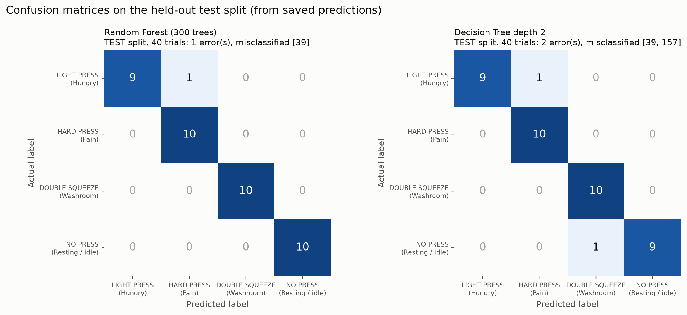
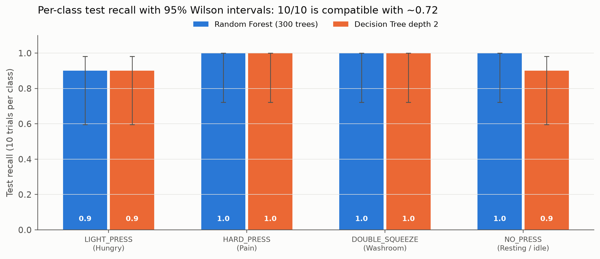
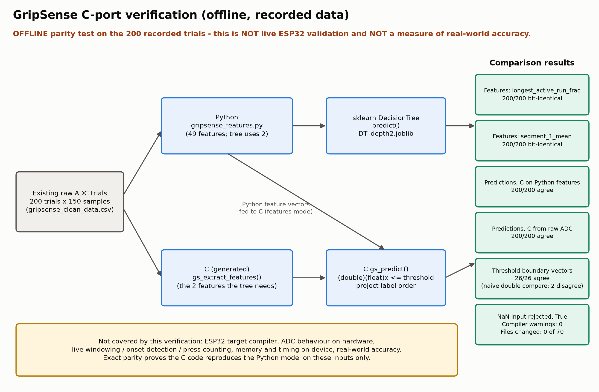
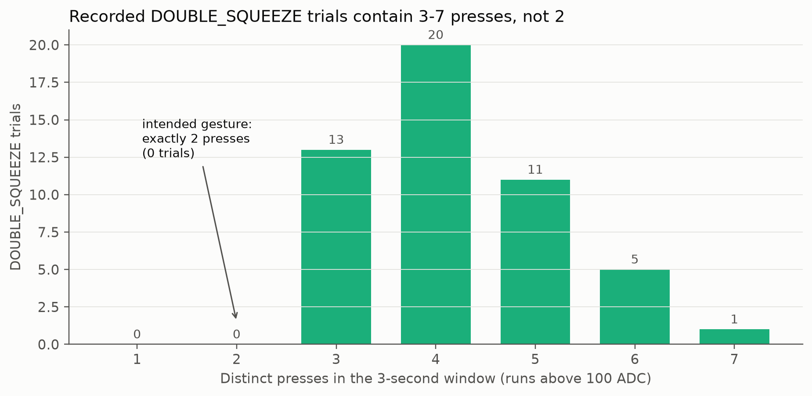

# GripSense - ESP32 FSR Pressure-Gesture Recognition with TinyML: Project Report

_Report date: 2026-10-10. Generated from the project's saved artifacts by
`results/project_documentation/scripts/build_documentation.py`. Every number was re-derived from the raw CSV,
saved predictions and verification files, and checked against the saved metrics before writing._

> **Scope statement.** This report documents offline, software-only work on an existing recorded dataset. No new
> data was collected, no ESP32 was connected, and no hardware or live-inference testing was performed. GripSense
> is a prototype. It is **not** a validated medical device, diagnostic system, or dependable emergency-alert system.

## 1. Title and project overview

**GripSense** is an assistive-communication prototype. A person squeezes a force-sensitive resistor (FSR) in
one of a few predefined ways, and the system turns that grip pattern into a short message for a caretaker. It is
intended for people who find speaking or using a phone difficult. The problem it addresses is turning a noisy
analog pressure signal into a small, fixed set of intentional gestures, reliably enough to be useful and with
little enough computation to run on a microcontroller.

The components and their status:

- **FSR pressure sensor.** Converts grip force into a resistance change that the ESP32 reads as an ADC value
  (0-4095 scale). The recorded values range 0-2608.
- **ESP32.** Sampled the sensor every 20 ms to produce the recorded dataset. The firmware that recorded the data
  is **not** in this project, so its exact configuration is not verified.
- **TinyML model.** Machine-learning models were trained offline in Python on trial-level features. A compact
  depth-2 decision tree was exported to plain C and verified against Python. It has **not** run on an ESP32.
- **Dashboard / Firebase.** A separate repository, `~/Desktop/gripsense-dashboard`, contains a Firebase Realtime Database
  caretaker dashboard. Its documented data contract expects the ESP32 to write events with actions
  `LIGHT_PRESS`, `HARD_PRESS`, `DOUBLE_SQUEEZE` (no `NO_PRESS`). It lives outside this project. The
  dashboard was not run, and its connection to the ML model was **not** verified.

At a high level, the system is: FSR -> ESP32 ADC samples -> 3-second window -> features -> classifier -> intended
message. In this project, the steps from the recorded CSV through offline evaluation and the C parity test are
implemented and verified. Everything on the device side remains planned or unverified (Figure 1, Section 15).

## 2. Executive summary

- **What was built:** an offline pipeline that audits the recorded FSR dataset, splits it by whole trial,
  extracts 49 features per 3-second trial, trains and compares 8 models, and exports a depth-2 decision
  tree to standalone C with an automated Python-vs-C parity test.
- **Data:** 30,000 ADC readings = 200 trials x 150 samples (20 ms apart, 3 s per trial), 50 trials
  for each of 4 labels.
- **Methods:** majority-class and mean-ADC baselines, Random Forest (300 trees), logistic regression (C = 0.1, 1, 10),
  and shallow decision trees (depth 2 and 3).
- **Measured performance (40 held-out test trials):** Random Forest 0.975 (39/40),
  logistic regression C=1 0.975, depth-2 tree 0.950 (38/40). Baselines:
  0.250 and 0.750. All trained models tied on validation (0.975),
  and their test differences (1-2 trials) are not statistically significant.
- **Model chosen for the C port:** the depth-2 decision tree. It was the **smallest** model tied at the best validation
  score (7 nodes, 2 features, ~84 bytes of tables), not the most accurate one.
- **C-port verification (offline):** C matched scikit-learn on **200/200** trials given Python features and
  **200/200** when computing its own features from raw ADC. Both C features were bit-identical (200/200, 200/200),
  the threshold-boundary tests passed 26/26, and compilation produced 0 warnings under strict flags.
- **Main limitations:** small test set (10 trials per class); DOUBLE_SQUEEZE recordings contain 3-7 squeezes rather
  than two; classes were recorded in sequential blocks; most presses are captured mid-hold; and there has been no
  hardware or live-stream validation.
- **Remaining work:** keep the C and Python implementations synchronized, add regression tests, build and measure on the
  ESP32 toolchain, and design live windowing with an "uncertain" output.

## 3. Problem statement and objectives

The task is to classify one 3-second window of FSR readings into one of four labels. The labels and their intended
meanings, exactly as used in the dataset:

| Label | Intended meaning | Trials |
|---|---|---|
| `LIGHT_PRESS` | Hungry | 50 |
| `HARD_PRESS` | Pain | 50 |
| `DOUBLE_SQUEEZE` | Washroom | 50 |
| `NO_PRESS` | Resting / idle | 50 |

These meanings are **design intentions** of the project. A correct classification only means that the grip
pattern matched a recorded pattern. It does not show that the system can infer a person's actual needs or medical
condition.

Objectives: (1) audit the dataset before modelling; (2) build a leakage-free trial-level evaluation; (3) compare simple
and stronger models against baselines; (4) pick a model suitable for a microcontroller; (5) port it to C and prove
equivalence to the Python model; (6) document limitations honestly.

## 4. System architecture



*Figure 1. System architecture and methodology. Solid boxes are implemented and verified offline; grey boxes are
existing inputs; dashed boxes are planned or not verified.*

1. **FSR pressure sensor.** Physical input. Its characteristics (divider resistor, placement) are not documented in
   the project.
2. **ESP32 analog input.** Produced ADC samples at a nominal 20 ms interval. Firmware not in the project; not verified.
3. **Data preparation / CSV.** `gripsense_clean_data.csv` with columns `trial`, `label`, `elapsed_ms`, `adc`.
   Prior cleaning steps (before this project) are not documented. This project performed no further cleaning and
   removed no data.
4. **Feature extraction.** `gripsense_features.py` turns each trial's 150 readings into 49 features. The same
   function is used for training and inference.
5. **Model training and evaluation.** `run_experiment.py` (phase 1) and `run_followup.py` (phase 2), validated by
   `validate_outputs.py` and `validate_followup.py`.
6. **Decision-tree export to C.** `export_and_verify_c_port.py` reads the fitted tree and generates
   `models/c_port/decision_tree.c`.
7. **C prediction and parity verification.** The same script compiles the C code and compares it with Python on all 200 trials.
8. **Embedded deployment.** Planned; not performed.
9. **Dashboard / Firebase.** A separate repository exists (Section 1). Not integrated with or tested against this model.

## 5. Dataset description

All figures below were recomputed from `gripsense_clean_data.csv` for this report.

| Property | Verified value |
|---|---|
| Rows | 30,000 |
| Columns | trial, label, elapsed_ms, adc |
| Trials | 200 |
| Samples per trial | 150 |
| Trials per label | LIGHT_PRESS 50, HARD_PRESS 50, DOUBLE_SQUEEZE 50, NO_PRESS 50 |
| Rows per label | LIGHT_PRESS 7,500, HARD_PRESS 7,500, DOUBLE_SQUEEZE 7,500, NO_PRESS 7,500 |
| Sampling interval | 20 ms (every interval) |
| elapsed_ms range per trial | 0-2980 ms (3.0 s window) |
| ADC range | 0-2608 (12-bit scale 0-4095; no saturation) |
| Missing values / duplicate rows | 0 / 0 |
| Labels per trial | exactly 1 (max observed 1) |
| Recording order | LIGHT_PRESS: trials 1-50; HARD_PRESS: trials 51-100; DOUBLE_SQUEEZE: trials 101-150; NO_PRESS: trials 151-200 |

Each trial is one 3-second window of 150 consecutive samples with a single label. Zero readings are normal when the
sensor is unloaded: LIGHT_PRESS 1.6%, HARD_PRESS 0.4%, DOUBLE_SQUEEZE 45.6%, NO_PRESS 99.6% of readings are 0.
The phase-1 audit ran **before** any training, and none of its checks failed ({'PASS': 28, 'INFO': 12, 'WARN': 3}). 20 trials were flagged for review
and kept (LIGHT_PRESS: 7, HARD_PRESS: 11, DOUBLE_SQUEEZE: 0, NO_PRESS: 2).

## 6. Data preparation and splitting

The split is stratified by label and done on **whole trial IDs** with seed 42 (`reports/split_manifest.csv`):

| Split | Trials | Readings | Per class (LIGHT / HARD / DOUBLE / NO) |
|---|---|---|---|
| train | 120 | 18,000 | 30 / 30 / 30 / 30 |
| validation | 40 | 6,000 | 10 / 10 / 10 / 10 |
| test | 40 | 6,000 | 10 / 10 / 10 / 10 |

No trial appears in more than one split (verified overlap = 0). Splitting by trial matters because the 150
samples within a trial are strongly correlated. Splitting individual samples at random would put near-identical
neighbouring samples in both training and test data, which would make the test score look better than it really is
(leakage).

**Test-set history.** The Random Forest's test result was examined during the initial experiment, and that pipeline
was re-run after the test score had been seen (see the run-history note in `reports/GripSense_TinyML_Report.md`;
features, split and candidate models were unchanged). In phase 2 the selection rules were frozen before the new candidates were scored on test. The test set
is therefore **not a completely untouched final evaluation** for every later decision. Saved disclosure: _Phase 1 already computed and reported RF_existing test results (39/40, trial 39 misclassified); the phase-1 run history also discloses a rerun after the test score was seen. The test set is therefore NOT completely untouched. In phase 2, selection rules were frozen (selection_freeze.json) before any test prediction of the new candidates. run_followup.py was executed more than once while the report text was being corrected; between runs only report wording changed - the split, candidates, selection rules and selected models were identical in every run._

## 7. Feature engineering

All models use the same 49 trial-level features from `gripsense_features.py`: level statistics (mean, median, std,
min, max, range, percentiles, IQR, RMS), contact features (zero fraction, longest zero/active runs, active mean),
threshold fractions (50-2000 ADC), press-event counts, peak position, consecutive-difference statistics, and the mean
and max of 10 equal time segments. Trial ID and timestamps are never features. The models differ in which features they
actually use: the Random Forest uses 47, logistic regression all 49, and the depth-2 tree only 2.

**Features used by the depth-2 tree (verified in source code).**

- `longest_active_run_frac` = (longest run of consecutive samples with ADC > 100) / 150. Dimensionless, 0-1.
  Source: `ACTIVE_THRESHOLD = 100` and `_longest_run(active) / n` in `gripsense_features.py`.
- `segment_1_mean` = mean ADC of samples 15-29 (the 2nd of 10 equal segments from `np.array_split`),
  i.e. 300-580 ms into the window. Unit: ADC counts.

**Why the C implementation must preserve these exactly.** The tree's thresholds only make sense for features with the
same definition, units and order. The C code must keep: (a) feature order, since the tree indexes features by
position; (b) the comparison operator (`<=` goes left); (c) numeric precision, because scikit-learn casts inputs to
float32 before comparing with float64 thresholds, so a plain double comparison can choose the other branch next to a
threshold; and (d) the class-label mapping, because scikit-learn stores classes alphabetically while the C interface
uses the project order. Getting any of these wrong would produce silent misclassifications.

## 8. Machine-learning methods

Hyperparameters below were read from the saved estimators, not from memory.

| Model | Configuration (verified) | Purpose | Strengths | Weaknesses |
|---|---|---|---|---|
| Majority-class baseline | always predicts one class (classes are tied) | chance floor | trivial | 25% by construction |
| Mean-ADC baseline | nearest class centroid on trial mean ADC | does force level alone suffice? | 1 feature, 16 B | confuses LIGHT with DOUBLE |
| Random Forest | 300 trees, max_features=sqrt, max_depth=None, class_weight=balanced, gini, seed 42 | strong non-linear reference | robust, little tuning | large (2,556 nodes), 47 features |
| Logistic Regression | standardscaler + logisticregression; C = 0.1 / 1 / 10; lbfgs, L2 (l1_ratio=0.0), max_iter=5000 | linear reference | smooth probabilities, ~1.2 KB | needs all 49 features + scaling |
| Decision Tree | max_depth = 2 / 3, gini, seed 42 | embedded candidate | 7 nodes, 2 features, readable rules | coarse; fixed time-slice feature |

**Why a compact tree suits embedded inference.** On a microcontroller, the cost includes computing the features as
well as storing the model. The depth-2 tree needs only two cheap features (a run-length count and a 15-sample mean) and
at most two comparisons. The Random Forest needs 47 features and ~30,672 bytes of tree tables (estimate). The tree
is **not more accurate** than the strong models. On test it made 2 errors against the RF's 1. It was chosen because it tied on
validation and is far smaller.

## 9. Model evaluation and comparison

| Model | Val acc | Test acc | Val macro-F1 | Test macro-F1 | Test errors | Misclassified (test) | Approx. size (method) | Features |
|---|---|---|---|---|---|---|---|---|
| Majority-class baseline | 0.250 | 0.250 | 0.100 | 0.100 | 30 | 30 trials | 1 B (1 label) | 0 |
| Mean-ADC baseline | 0.725 | 0.750 | 0.714 | 0.734 | 10 | 10 trials | 16 B (4 floats) | 1 |
| Random Forest (300 trees) | 0.975 | 0.975 | 0.975 | 0.975 | 1 | 39 | 30,672 B (2556 nodes) | 47 |
| Logistic Regression C=0.1 | 0.975 | 0.950 | 0.975 | 0.950 | 2 | 39, 111 | 1,192 B (298 float params) | 49 |
| Logistic Regression C=1 | 0.975 | 0.975 | 0.975 | 0.975 | 1 | 39 | 1,192 B (298 float params) | 49 |
| Logistic Regression C=10 | 0.975 | 0.975 | 0.975 | 0.975 | 1 | 39 | 1,192 B (298 float params) | 49 |
| Decision Tree depth 2 | 0.975 | 0.950 | 0.975 | 0.950 | 2 | 39, 157 | 84 B (7 nodes) | 2 |
| Decision Tree depth 3 | 0.975 | 0.950 | 0.975 | 0.950 | 2 | 39, 157 | 84 B (7 nodes) | 2 |



*Figure 2. Validation and test accuracy with 95% Wilson intervals (40 trials per split).*

**Reconciliation with the summary table supplied for this report.** All supplied values match the saved metrics.
The artifacts contain two more models than the six listed: logistic regression C=10 (test 0.975) and a depth-3 tree.
The depth-3 tree is structurally identical to the depth-2 tree (7 nodes), with test 0.950. The majority baseline's
"size" is 1 stored label.

**Size is not measured the same way for every model.** The RF and tree sizes are estimates at 12 bytes per node.
Logistic regression is 4 bytes per float parameter, including the scaler's means and scales. The depth-2 tree's
84 bytes was also **measured** as the `sizeof` of its C tables on the host. None of these include
feature-extraction code, so they are not a full deployment comparison (Figure 3).



*Figure 3. Approximate model size (log scale). Estimates are hatched; the measured host value is shown in orange.*

**Confusion matrices (test, 40 trials; rows = actual, columns = predicted).**

Random Forest:

| Actual \ Predicted | LIGHT_PRESS | HARD_PRESS | DOUBLE_SQUEEZE | NO_PRESS |
|---|---|---|---|---|
| **LIGHT_PRESS** | 9 | 1 | 0 | 0 |
| **HARD_PRESS** | 0 | 10 | 0 | 0 |
| **DOUBLE_SQUEEZE** | 0 | 0 | 10 | 0 |
| **NO_PRESS** | 0 | 0 | 0 | 10 |

Depth-2 decision tree:

| Actual \ Predicted | LIGHT_PRESS | HARD_PRESS | DOUBLE_SQUEEZE | NO_PRESS |
|---|---|---|---|---|
| **LIGHT_PRESS** | 9 | 1 | 0 | 0 |
| **HARD_PRESS** | 0 | 10 | 0 | 0 |
| **DOUBLE_SQUEEZE** | 0 | 0 | 10 | 0 |
| **NO_PRESS** | 0 | 0 | 1 | 9 |



*Figure 4. Test-split confusion matrices from the saved predictions.*

**Interpretation.** Every trained model clearly beats both baselines. The mean-ADC baseline reaches only
0.750 because LIGHT_PRESS and DOUBLE_SQUEEZE have similar average force. Between the trained models,
exact McNemar tests against the RF found significant differences only for the baselines (Majority-class baseline, Mean-ADC baseline). None were
found for Logistic Regression C=0.1, Logistic Regression C=1, Logistic Regression C=10, Decision Tree depth 2, Decision Tree depth 3. The test error shared by every trained model is trial 39, a LIGHT_PRESS (Hungry) predicted as
HARD_PRESS (Pain): a false "Pain" signal. The depth-2 tree also called NO_PRESS trial 157 (which contains a brief
contact) DOUBLE_SQUEEZE.

**Uncertainty.** The test set has only 10 trials per class. A perfect 10/10 recall is consistent with a true recall as
low as 0.72, and 9/10 with 0.60 (95% Wilson). One trial changes overall accuracy by 0.025. In an exploratory 20x
repeated 5-fold cross-validation on all 200 trials, fold accuracy for the RF ranged 0.925-1.000 (mean 0.981), and for
the depth-2 tree 0.925-1.000 (mean 0.970).



*Figure 5. Per-class test recall with 95% Wilson intervals.*

## 10. Decision-tree-to-C export

- **Source artifact:** `models/followup/DT_depth2.joblib` (SHA-256 `d8c854e47f0dbb8e...`; unchanged).
- **Generation:** `export_and_verify_c_port.py` loads the fitted `DecisionTreeClassifier` and reads `tree_.feature`,
  `tree_.threshold`, `children_left/right` and `tree_.value` programmatically. It then writes flattened C tables, with
  thresholds as exact hex-float literals. Nothing is hand-written.
- **Features in C:** `gs_extract_features()` computes `longest_active_run_frac` and `segment_1_mean` from 150 `uint16_t`
  ADC samples.
- **Class-index mapping (verified from the compiled harness `--info`):** `LIGHT_PRESS = 0`, `HARD_PRESS = 1`, `DOUBLE_SQUEEZE = 2`, `NO_PRESS = 3`.
  The leaves are mapped **by name** from scikit-learn's alphabetical order (DOUBLE_SQUEEZE, HARD_PRESS, LIGHT_PRESS, NO_PRESS).
- **Comparison:** `node = ((double)(float)v <= GS_THRESHOLD[node]) ? left : right`, reproducing scikit-learn's float32 cast.

| Node | Type | Feature | Threshold (float64) | Left / Right | Leaf class (C index) |
|---|---|---|---|---|---|
| 0 | split | `longest_active_run_frac` | 0.35333333909511566 | 1 / 4 |  |
| 1 | split | `longest_active_run_frac` | 0.046666666865348816 | 2 / 3 |  |
| 2 | leaf |  |  |  | NO_PRESS (= 3) |
| 3 | leaf |  |  |  | DOUBLE_SQUEEZE (= 2) |
| 4 | split | `segment_1_mean` | 840.6333312988281 | 5 / 6 |  |
| 5 | leaf |  |  |  | LIGHT_PRESS (= 0) |
| 6 | leaf |  |  |  | HARD_PRESS (= 1) |

```
if ((float)longest_active_run_frac <= 0.35333333909511566):
    if ((float)longest_active_run_frac <= 0.046666666865348816):
        -> NO_PRESS
    else:
        -> DOUBLE_SQUEEZE
else:
    if ((float)segment_1_mean <= 840.6333312988281):
        -> LIGHT_PRESS
    else:
        -> HARD_PRESS
```

- **Compilation:** `cc` (Apple clang version 21.0.0 (clang-2100.3.34.2)) with `-std=c99 -O2 -Wall -Wextra -Wpedantic -Wconversion -Wsign-conversion -Wshadow -Wdouble-promotion -Wstrict-prototypes -Wmissing-prototypes -Wfloat-equal -Wcast-qual -Wformat=2 -Wundef -Wvla`.
  Result: **0 warnings**. An earlier build produced 2 unused-variable warnings in the library build, which were fixed by
  adding name-lookup functions rather than by suppressing the warnings.
- **Files:** `models/c_port/decision_tree.c` (generated source), `models/c_port/tree_metadata.json`,
  `models/c_port/build/decision_tree` (host test harness), `models/c_port/build/decision_tree.o` (library object).

**Why the float32 semantics matter.** The thresholds are float32 midpoints stored as float64. In the boundary test set, a naive
double-precision comparison disagreed with scikit-learn on **2** of 26 vectors. The ported comparison
agreed on all of them. On the 200 real trials the naive comparison happened to disagree on
0, but exactness should not depend on luck.

## 11. C-port verification results



*Figure 6. Offline C-port verification flow and results (recorded data only; not live ESP32 validation).*

| Check (from results/c_port/verification_summary.json) | Result |
|---|---|
| C predictions on Python-computed features vs scikit-learn | **200/200** |
| C predictions from raw ADC (C computes features) vs scikit-learn | **200/200** |
| C vs Python feature values: longest_active_run_frac | 200/200 bit-identical |
| C vs Python feature values: segment_1_mean | 200/200 bit-identical |
| Threshold-boundary tests | 26/26 |
| scikit-learn predictions vs saved phase-2 predictions (80 val+test trials) | True |
| NaN input rejected | True |
| Strict compiler warnings | 0 |
| Pre-existing files changed during the C-port work | 0 of 70 |
| All checks pass | **True** |

The ported tree's accuracy against the recorded labels is unchanged from Python: test 0.950, train 1.000, validation 0.975.

**What parity proves.** Exact agreement shows the C code is **equivalent to the Python model on these 200 recorded
inputs**. It does not show real-world accuracy, generalisation to new users or sessions, correct behaviour on a live
signal stream, or successful ESP32 deployment.

**Host size measurements (macOS arm64; not ESP32 figures).** Tree tables `sizeof` = 84 bytes; library object
`size` total = 1367 bytes (`__TEXT` 1159, `__DATA` 48); test
executable on disk = 34,560 bytes. The executable's very large `others` value from `size` is the macOS
`__PAGEZERO` reservation, not code or data.

## 12. Findings and interpretation

1. **Strong results on the existing trial-level split.** Trained models reach 0.950-0.975 on validation and test,
   far above the baselines (0.250 and 0.750).
2. **Multiple models score alike.** 6 of 6 trained candidates tied on validation, and their test differences are 1-2 trials.
   The data does not single out a "best" model.
3. **A small tree is attractive for embedded use.** It is accurate to within one or two trials of the RF on this data, needs two
   features, and is about 84 bytes of tables. These are advantages in size and simplicity, not in accuracy.
4. **High accuracy here is not proven real-world reliability.** The data comes from one recording effort with
   protocol issues (Section 13). The test set is small and was previously inspected.
5. **Parity is essential when moving Python to C.** The float32-cast detail would have caused silent disagreements
   at threshold boundaries. Automated parity tests caught and pinned this behaviour.

## 13. Data quality and methodological limitations

- **DOUBLE_SQUEEZE does not contain a double squeeze.** Presses per trial: {3: 13, 4: 20, 5: 11, 6: 5, 7: 1} (presses: trials), median
  4. 0 trials contain exactly 2. The median press lasts 430 ms with a 280 ms gap (rhythmic squeezing). The
  model may therefore recognise repeated or rhythmic squeezing rather than the intended two-squeeze gesture (Figure 7).
- **Sequential recording blocks.** LIGHT_PRESS: trials 1-50; HARD_PRESS: trials 51-100; DOUBLE_SQUEEZE: trials 101-150; NO_PRESS: trials 151-200. Sensor baseline
  drift or changes in force over time are confounded with class. Peak DOUBLE_SQUEEZE force rose over its block
  (Spearman rho +0.38, p = 0.00716).
- **Presses captured mid-hold.** 45/50 LIGHT_PRESS and 49/50 HARD_PRESS windows are already above 100 ADC at
  t = 0, so press onset is mostly not represented.
- **Flagged trials retained.** 20 unusual trials were flagged and kept (LIGHT_PRESS: 7, HARD_PRESS: 11, DOUBLE_SQUEEZE: 0, NO_PRESS: 2), including NO_PRESS
  trial 156 (atypical_zero_fraction(z=-5.6); activity_during_no_press(max=186)); trial 157 (atypical_mean(z=+6.9); atypical_std(z=+7.0); atypical_max(z=+6.9); atypical_zero_fraction(z=-4.6); atypical_mean_abs_diff(z=+6.5); activity_during_no_press(max=704)).
- **Small test set.** 10 trials per class (Section 9).
- **Confidence thresholds do not reliably remove errors.** An RF threshold of 0.80, chosen on validation, accepted
  0.925 of test trials and still accepted 1 error (trial 39, confidence 0.83).
- **Simulated window edits are exploratory only.** Synthetic edits of real recordings suggested weaknesses. With rest
  added before and after LIGHT/HARD presses, the RF predicted DOUBLE_SQUEEZE for 40/40. A single squeeze was called
  DOUBLE_SQUEEZE 11/20 times, and "two squeezes then rest" 18/20. These are edits, not real experiments.
- **The C port only covers complete, pre-cut 3-second windows.** It is not a live gesture detector: live windowing,
  gesture-start detection and squeeze counting are not implemented or verified.
- **No ESP32 validation.** Target ADC readings, target-compiler behaviour (including float handling), memory use and live
  inference have not been validated.



*Figure 7. Distinct presses per DOUBLE_SQUEEZE trial (runs above 100 ADC).*

These limitations mean the reported accuracies describe agreement with **this recording**. Performance on new users,
new sessions, a live stream, or a correctly performed double squeeze is unknown.

## 14. Security, safety, and intended-use boundaries

- GripSense is a **prototype**. It is not a validated medical device, a diagnostic system, or a dependable
  emergency-alert system, and it must not be the only channel for pain or emergency communication.
- Misclassification produces a wrong intended message. The observed error type (LIGHT_PRESS -> HARD_PRESS) is a false
  "Pain" signal. Missed signals are also possible.
- Before any real use: user testing with the intended users and caretakers, explicit failure handling (sensor
  disconnected, saturated or noisy input), an "uncertain - please repeat" output, confirmation feedback (LED/vibration),
  and acknowledgement handling on the caretaker side.
- Security: the separate dashboard documents that only client-side Firebase Web App configuration belongs in the web
  app. Database access rules and device authentication were not reviewed in this project.

## 15. Current status

| Component | Status | Evidence |
|---|---|---|
| Dataset (CSV) and audit | Completed | `gripsense_clean_data.csv`, `reports/dataset_audit.csv` |
| Trial-level split | Completed | `reports/split_manifest.csv` (120/40/40) |
| Model training (8 models) | Completed | `results/followup/model_comparison.csv` |
| Model evaluation | Completed on the existing split (test previously inspected) | `reports/followup/followup_metrics.json` |
| C code generation (depth-2 tree) | Completed | `models/c_port/decision_tree.c` |
| Offline C/Python parity tests | Completed: 200/200 and 200/200 | `results/c_port/verification_summary.json` |
| Host compilation (Apple clang) | Completed, 0 warnings | `results/c_port/compile_log.txt` |
| ESP32 firmware source | Not found in project | No `.ino`/PlatformIO/ESP-IDF files found |
| ESP32 target compilation | Not verified | No target build artifacts |
| Live sensor inference | Not verified | No hardware tests were run |
| Live windowing / onset detection / press counting | Not implemented | C port classifies pre-cut windows only |
| Firebase / caretaker dashboard | Exists as a separate repository; not integrated with or tested against the ML model | `~/Desktop/gripsense-dashboard` (outside this project) |

## 16. Recommended next steps (software-only first)

1. **Keep C and Python synchronized.** Regenerate `decision_tree.c` from the saved model, never edit it by hand, and
   re-run `export_and_verify_c_port.py` after any feature or model change.
2. **Add deterministic regression tests** for all 200 trials and the 26 boundary vectors. Run them as a CI-style check
   with fixed expected outputs.
3. **When hardware work resumes:** compile with the ESP32 target toolchain and repeat the parity test on target
   (or in an emulator).
4. **Measure target memory and inference timing** for the sampler, the 300-byte window buffer, feature extraction and the tree.
5. **Plan live windowing and invalid-input handling:** a sliding window or onset trigger, two-in-a-row agreement,
   an "uncertain" state, and rejection of disconnected or saturated input.
6. **Document label and window-alignment limits** wherever the model is used (Section 13).
7. **If more data ever becomes possible,** design a better-controlled evaluation (interleaved classes, separate sessions)
   rather than treating the current split as definitive. This is not required now.

## 17. Reproducibility

Run from the project folder (note the trailing space in the folder name):

```bash
cd "/Users/zenith/Desktop/GripSense-TinyML "
.venv/bin/python export_and_verify_c_port.py
.venv/bin/python validate_followup.py
./models/c_port/build/decision_tree --info
.venv/bin/python results/project_documentation/scripts/build_documentation.py
.venv/bin/python results/project_documentation/scripts/check_documentation.py
```

The first two commands regenerate their own timestamped outputs. For this documentation package they were therefore
executed in a **temporary copy** of the project, so that existing files stayed untouched. The `--info` command was run
in place (read-only). Results: `QUALITY_CHECKS.md`. Environment: Python 3.12.13, scikit-learn 1.9.1,
numpy 2.5.3, pandas 3.0.6, matplotlib 3.11.2; PDF built with reportlab and checked with pypdf
(installed into `.venv` for this documentation only; `requirements.txt` unchanged). Seed 42.

## 18. Artifact index

| Path | Purpose |
|---|---|
| `results/project_documentation/GripSense_Project_Report.md` | this report (Markdown) |
| `results/project_documentation/GripSense_Project_Report.pdf` | this report (PDF) |
| `results/project_documentation/GripSense_Executive_Summary.md` | 2-3 minute summary |
| `results/project_documentation/README.md` | entry point with links |
| `results/project_documentation/manifest.json` | list of every deliverable |
| `results/project_documentation/QUALITY_CHECKS.md` | documentation quality-control results |
| `results/project_documentation/figures/*.png` | 7 figures used in this report |
| `results/project_documentation/report_facts.json` | all values used in this report |
| `results/project_documentation/scripts/` | builder and checker scripts |
| `reports/GripSense_TinyML_Report.md` | phase-1 report (audit, split, baselines, RF) |
| `reports/followup/GripSense_TinyML_Final_Report.md` | phase-2 report (comparison, protocol, exploratory) |
| `reports/c_port_report.md` | C-port report |
| `models/c_port/decision_tree.c` | generated C implementation |
| `results/c_port/verification_summary.json` | C-port verification results |

## 19. Conclusion

What has been demonstrated: on the recorded GripSense dataset, simple trial-level features separate the four grip
patterns well (0.950-0.975 on a small, previously inspected test set). A 7-node decision tree using two features
performs within one or two trials of a 300-tree Random Forest. That tree has been exported to standalone C that
reproduces the Python model exactly on all 200 recorded trials, from features and from raw ADC.

What remains unproven: real-world accuracy, behaviour on new users or sessions, recognition of a genuine double squeeze,
live-stream windowing, and anything on the ESP32 itself.

Next practical software-only milestone: turn the parity check into a fixed regression test suite (200 trials + 26
boundary vectors), and draft the live-windowing logic (onset trigger, two-in-a-row agreement, "uncertain" state) as
host-side C, tested against the recorded trials.
